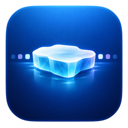

  
  <h1>FloeBar</h1>
  
A calm, capable menu bar organizer for macOS.

FloeBar keeps a crowded Mac menu bar under control. Hide items you rarely need,
reveal them with one click, arrange them visually, search them, and customize the
menu bar without replacing the native macOS experience.

> [!NOTE]
> FloeBar is an independently maintained GPLv3 fork of
> [Ice](https://github.com/jordanbaird/Ice) by Jordan Baird. It is not affiliated
> with or endorsed by the upstream project. See [NOTICE.md](NOTICE.md) for full
> attribution.

## Version 0.13.0-macos27.38

Build `0.13.0-macos27.38 (1367)` fixes native drag ordering, application
visibility and recovery on macOS 27. After explicitly authorizing the system
menu bar preferences file, you can select supported third-party applications
to hide or show. FloeBar validates system ownership and installation identity,
including the system-declared WPS application/helper group. Unsupported items
remain unavailable. Changes are journaled before writing and restored on normal
quit or the next launch after a crash.

Layout uses a single ordering row. Hidden applications must be shown before
dragging their items; interrupted gestures are not automatically replayed.
The native system overflow and its double-chevron remain. macOS 14–26 retain
the legacy backend. Private assertion hiding remains disabled on every launch.

The [implementation and acceptance record](docs/plans/native-overflow-root-fix.md)
includes real mouse dragging, repeated WPS hide/show and normal/crash recovery.
The universal release is Developer ID signed, notarized by Apple and stapled.
Its Sparkle signing key is rotated through the existing Developer ID team;
native update validation and file installation from the published 1330 release
were checked on isolated copies, including rejection of an invalid signature.
See [distribution](docs/distribution.md) for signing and update requirements.

## Install

1. Download the latest `FloeBar-*.zip` from
   [GitHub Releases](https://github.com/JackFloyd007/FloeBar/releases/latest).
2. Open the ZIP and move `FloeBar.app` to `/Applications`.
3. Launch FloeBar and grant Accessibility permission when prompted.
4. Grant Screen Recording permission only if you want exact menu bar previews
   and the separate Floe Bar panel.

FloeBar release builds are signed with Developer ID, notarized by Apple, and
update through their own Sparkle feed. They do not use the original Ice update
channel.

## Features

- Hide and reveal menu bar items in visible, hidden, and always-hidden sections.
- Arrange supported items with a visual drag-and-drop layout.
- Search menu bar items and trigger configurable hotkeys.
- Show hidden items in a separate Floe Bar panel.
- Customize menu bar tint, shape, shadow, border, and item spacing.
- Launch at login and receive signed automatic updates.
- Native macOS 27 compatibility for menu bar discovery and section boundaries.

## Permissions and privacy

FloeBar does not collect or transmit personal data.

- **Accessibility** is required to discover and arrange menu bar items.
- **Screen Recording** is optional and is used only to render the real appearance
  of menu bar items in Layout and the Floe Bar.

Permissions stay on the Mac and can be revoked at any time in System Settings.

## Compatibility

**macOS 27 (build 1367):** supported third-party applications can
be hidden through explicitly authorized system preferences. System-declared
groups are controlled together; unsupported or ambiguous ownership is rejected.
The system chevron remains. See the
[current implementation and acceptance](docs/plans/native-overflow-root-fix.md).

FloeBar requires macOS 14 or later. The maintained branch includes a dedicated
macOS 27 path that avoids global input interception and fails open when the
native menu bar boundary cannot be verified. Known limitations and technical
validation are documented in [MACOS27.md](MACOS27.md).

## Languages and macOS 27 status

FloeBar includes English, Simplified Chinese, Traditional Chinese, Japanese,
Korean, German, French, Spanish and Brazilian Portuguese. It follows the
language selected for the app in macOS.

On macOS 27, application selection controls supported hiding and Layout arranges
visible items. Screen capture stays off until you explicitly request previews.
The separate Floe Bar, search, hover/scroll triggers and automatic rehiding remain
unavailable on macOS 27. Older macOS releases, multiple displays and unsupported
system items are outside the latest real-device acceptance. See the
[current test record](docs/plans/native-overflow-root-fix.md) for coverage and limits.

## Build from source

Requirements:

- macOS 14 or later
- Current Xcode with the macOS SDK
- SwiftLint, if you want to run the same lint step as CI

Open `FloeBar.xcodeproj`, select the `FloeBar` scheme, and build. Swift package
dependencies are resolved by Xcode. Release signing and notarization instructions
are in [docs/distribution.md](docs/distribution.md).

Run the pure regression and localization checks with `bash scripts/test.sh`.
These checks do not interact with the live menu bar. They do not replace
physical-device validation of hiding and native input.

## Contributing

Bug reports and focused pull requests are welcome. Read
[CONTRIBUTING.md](CONTRIBUTING.md) before opening a change, and report security
issues according to [SECURITY.md](SECURITY.md).

## License and attribution

FloeBar is distributed under the [GNU General Public License v3.0](LICENSE).
Modified versions and binaries must continue to satisfy GPLv3, including source
availability and preservation of applicable copyright notices.

FloeBar modifications are copyright © 2026 JackFloyd007. Portions are copyright
© 2024–2025 Jordan Baird and other Ice contributors.
