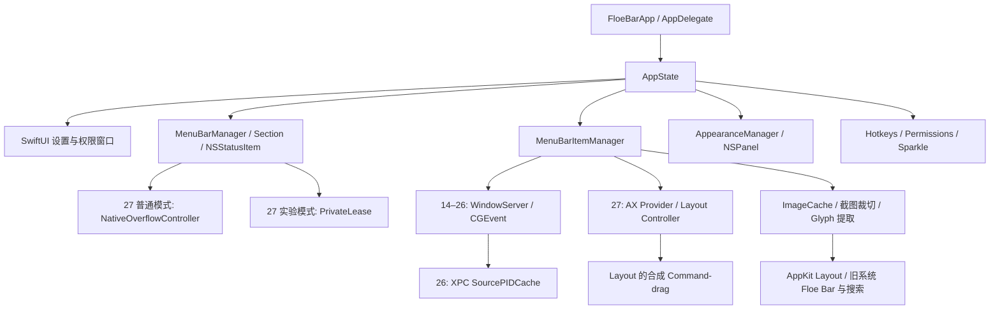

FloeBar 架构、功能与原生性审查（2026-10-31）
================================================

本文保留初审时的证据与问题描述。用户随后授权的修复和最新验证结果见文末「修复结果」；初审的构建失败和“未实施修复”属于修复前状态。

审查结论：这是一个已有较完整原生 UI 和菜单栏管理基础的 Ice 分支；当前 macOS 27 实现仍处于兼容性开发阶段。最大的缺口在于产品承诺与后端能力不一致、跨应用项目身份与输入验证不够严格，以及状态恢复和工程验收不完整。当前证据不足以支持“稳定、功能完整、全平台验收通过”的发布判断。

本次以工作区当前内容为准，包括已有未提交和未跟踪文件；没有修改应用源码、重排真实菜单栏、授予权限、开启实验隐藏、签名安装或发布。下文“源码确认”表示调用链和条件可由代码证明，不表示已在这台 Mac 上复现视觉或输入后果。

**实际验证与限制**

| 检查 | 本次结果 |
|---|---|
| 外置开发盘 | 守卫通过；外置、可写 APFS，UUID 与个人约定一致 |
| 环境 | Mac mini，macOS 27.2（26B123），Xcode 27.1（27A9275） |
| 审查版本 | HEAD `787a67f` 加当前工作区；项目标记 `0.13.0-macos27.6-dev (1335)` |
| 源码规模 | FloeBar / Shared / MenuBarItemService 共 131 个 Swift/ObjC/头文件，25,247 行；91 处 macOS 27 availability 分支（文本计数） |
| 纯逻辑回归 | `scripts/test.sh` 中 11 组全部通过 |
| 本地化资源 | 218 条、9 个 locale 的资源完整性和占位符检查通过；这不是九语言界面验收 |
| 当前源码完整 Debug 构建 | arm64、关闭签名；失败，退出码 65。xcresult 记录 3 个 SwiftLint error、61 个 warning |
| 现有 1335 包 | 在沙箱外 `codesign --verify --deep --strict` 通过；不等于已公证或等于当前源码 |
| 真实界面 | 桌面工具打开仓库中现有包超时，后续应用列表没有 FloeBar；未获得可审查截图，不据此断言 App 崩溃 |
| 未验证 | 多屏、全屏、自动隐藏菜单栏、快速开合、VoiceOver 实操、旧系统实机、性能仪器数据、当前包公证与自动更新端到端 |

证据：[测试日志](/Volumes/DeveloperSSD/Developer/Projects/floebar/build/review-20261031/tests.log)、[构建摘要](/Volumes/DeveloperSSD/Developer/Projects/floebar/build/review-20261031/build-summary.json)、[完整 xcresult](/Volumes/DeveloperSSD/Developer/Projects/floebar/build/review-20261031/DebugBuild.xcresult)。2026-09-20 的历史实机记录来自 macOS 27.0 / Xcode 27.0，不能作为当前 27.2 环境已经通过的证据。

**架构实际由什么组成**

这是单个主应用加一个 XPC 服务的结构。AppState 集中创建管理器，设置主要依赖 Combine / ObservableObject，持久化主要是 UserDefaults 和 JSON。功能目录有组织，但目录分开尚未形成清晰的系统后端接口。

[`MenuBarItemManager.swift`](/Volumes/DeveloperSSD/Developer/Projects/floebar/FloeBar/MenuBar/MenuBarItems/MenuBarItemManager.swift) 达 3,133 行，承担发现、缓存、事件注入、排序事务、布局预览、重试、验证和临时显示；macOS 27 分支散布在管理器、Section、ControlItem、设置、截图和快捷键等位置。新增一种能力或失效规则要同步很多入口，已经出现“右键菜单隐藏了功能、快捷键页仍保留”的不一致。建议逐步抽出 capability、discovery、visibility 和 reorder 边界，不需要先重写整套 UI。

**是否原生：需要分开判断**

| 层面 | 判断与依据 |
|---|---|
| 应用技术栈 | 原生。Swift / Objective-C，AppKit / SwiftUI；主代码未发现 Electron 或 WebView UI |
| 菜单栏入口 | 原生 `NSStatusItem`、`NSMenu`；AppKit 本身就是官方支持的菜单栏实现，不要求改为 MenuBarExtra 才算原生 |
| 设置与窗口 | `NavigationSplitView`、List、Toggle、Picker 等原生控件，配合自定义 IceForm / IceSection |
| Layout | `NSViewRepresentable → NSScrollView → 自绘 NSView`，显示截图提取的图形；不是直接嵌入其他 App 的原始 NSStatusItem |
| 外观效果 | 通过覆盖层 NSPanel 绘制颜色、形状、边框和阴影；是原生窗口绘图，不是系统提供的菜单栏换肤接口 |
| 第三方菜单栏控制 | AX 枚举、CGEvent 合成输入和内部系统结构假设；不能等同系统公开授权的任意跨应用隐藏接口 |
| 是否全公共 API | 否。普通路径也使用 `Shared/Bridging/Shims.swift` 中的 CGS 私有符号；实验隐藏还加载 MenuBarClientCore 私有框架 |

官方 [`NSStatusBar` 文档](https://developer.apple.com/documentation/appkit/nsstatusbar) 支持上述原生入口判断。若未来目标包含 Mac App Store，当前私有 API、非沙盒和 Sparkle 自更新路线需要单独评估；不能把现有 Developer ID 发行方式直接视为可提交商店。[Apple App Review Guidelines](https://developer.apple.com/app-store/review/guidelines/) 要求商店应用使用公共 API，并对 Mac App Store 的沙盒与更新方式设有限制。当前仓库本身走的是独立分发路线。

**当前功能矩阵：存在代码不等于所有系统可用**

| 能力 | macOS 14–26 路径 | macOS 27 普通模式 | macOS 27 实验模式 |
|---|---|---|---|
| 隐藏 / 展开 | 旧分区与占位项后端 | 控制系统 overflow，系统决定成员 | 私有 assertion，按整个应用控制 |
| 精确三分区隐藏 | 旧后端实现 | 不提供；分区标签不是隐藏保证 | 有归属限制，不能拆分同一 App 的项目 |
| Layout 排序 | 存在实现 | 原生菜单栏合成拖动；不支持的跨区隐藏分配会拒绝 | 同样的排序机制加隐藏资格限制 |
| 独立 Floe Bar | 存在实现 | 禁用 | 禁用 |
| 搜索 | 存在实现 | 禁用 | 禁用 |
| 悬停 / 滚动 / 自动收起 | 存在实现 | 禁用 | 禁用 |
| 项目间距 | 存在实现，有强退问题 | 设置入口隐藏 | 设置入口隐藏 |
| 颜色 / 形状 / 边框 / 阴影 | Overlay 实现 | Overlay 实现 | Overlay 实现 |
| 自定义入口图标 | 有效 | 固定入口；所选图标只用于实验模式 | 有效 |
| 登录启动 / 更新 | 集成 LaunchAtLogin / Sparkle | 同左 | 同左 |

依据：[GeneralSettingsPane.swift:39](/Volumes/DeveloperSSD/Developer/Projects/floebar/FloeBar/Settings/SettingsPanes/GeneralSettingsPane.swift:39)、[MenuBarSection.swift:266](/Volumes/DeveloperSSD/Developer/Projects/floebar/FloeBar/MenuBar/MenuBarSection.swift:266)、[MenuBarSearchPanel.swift:106](/Volumes/DeveloperSSD/Developer/Projects/floebar/FloeBar/MenuBar/Search/MenuBarSearchPanel.swift:106)。表中“存在实现”不是本次旧系统实机通过声明。

macOS 27 普通模式目前更接近“系统溢出辅助入口 + 布局排序 + 外观设置”。如果产品目标是稳定的任意项目隐藏、始终隐藏和独立第二栏，当前默认后端尚未实现该目标。私有模式的 45 秒租约、启动默认关闭和恢复机制是合理保护，但不会把未通过的时钟兼容性自动变成已解决；历史实验记录明确保留这个问题。

**优先问题：应在发布或继续扩展功能前处理**

1. **P1 · 同进程项目可能通过错误的拖动目标检查。源码确认，实际误操作待实机复现。**
   [`MacOS27MenuBarItemProvider.swift:118`](/Volumes/DeveloperSSD/Developer/Projects/floebar/FloeBar/MenuBar/MenuBarItems/MacOS27MenuBarItemProvider.swift:118) 只验证命中元素 PID 与项目相同、命中元素的矩形包含该点。它没有比较实际 AX identity。MenuBarAgent 的多个系统项，或同一个 App 的多个图标，都可能共享 PID。若 AX 坐标陈旧或重合，邻居仍能通过检查；[`MenuBarItemManager.swift:1437`](/Volumes/DeveloperSSD/Developer/Projects/floebar/FloeBar/MenuBar/MenuBarItems/MenuBarItemManager.swift:1437) 随后会发送 Command-drag。自有 boundary 已有更严格验证，其他项目却没有。图像缓存也复用该判断，因此还能截到同进程的错误图标。建议保留真实元素身份，在最终发送输入前核对同一元素或受控祖先关系；无法确认时拒绝。

2. **P1 · 旧系统“调整间距”可能丢失其他 App 的未保存内容。源码确认，未执行破坏性复现。**
   [`MenuBarItemSpacingManager.swift:84`](/Volumes/DeveloperSSD/Developer/Projects/floebar/FloeBar/MenuBar/Spacing/MenuBarItemSpacingManager.swift:84) 请求正常退出，一秒后在第 97 行调用 `forceTerminate()`。有菜单栏图标的应用可能同时承载文档、下载或会话，退出确认框也可能被强退覆盖。UI 只提示“重新启动相关应用”，没有明确强退策略。入口目前仅限 14–26。建议尊重拒绝退出，列出未应用对象并允许用户稍后重启；普通间距修改不应默认强退应用。

3. **P1 · 当前标准构建未通过，而且是否失败取决于本机是否安装 SwiftLint。本次实测。**
   新增 [`NativeOverflowController.swift:39`](/Volumes/DeveloperSSD/Developer/Projects/floebar/FloeBar/MenuBar/MenuBarItems/NativeOverflowController.swift:39)、第 40、66 行的 `as!` 触发三项 force_cast 错误。构建阶段检测到 SwiftLint 就运行，未安装则只警告；历史 1335 构建日志恰好写着“SwiftLint not installed”。所以旧日志的 BUILD SUCCEEDED 没覆盖当前门禁。这些转换前已有 CF 类型检查，不能仅据 lint 错误宣称存在类型转换崩溃；问题是标准构建/CI不可复现。应统一并固定检查版本、修复现有门禁，而非跳过检查宣称通过。

**其他明确缺陷与兼容性风险**

4. **P2 · 录屏权限后补授权无法在当前会话恢复。源码确认。**
   [`AppState.swift:60`](/Volumes/DeveloperSSD/Developer/Projects/floebar/FloeBar/Main/AppState.swift:60) 在正常 setup 时停止全部权限检查；[`AdvancedSettingsPane.swift:159`](/Volumes/DeveloperSSD/Developer/Projects/floebar/FloeBar/Settings/SettingsPanes/AdvancedSettingsPane.swift:159) 的 Grant 仅请求授权，不重启观察。与此同时 [`ScreenCapture.swift:54`](/Volumes/DeveloperSSD/Developer/Projects/floebar/FloeBar/Utilities/ScreenCapture.swift:54) 永久缓存 false，唯一主动 reset 的权限检查已经停止。仅给辅助功能后以 Limited Mode 继续，再补录屏权限，状态和截图能力仍会保持不可用直至重启。应在授权返回、App 激活和权限相关失败时刷新状态及缓存，并补这条集成测试。

5. **P2 · 重复 identifier 用位置编号，会在排序后交换身份；固定项保护也受影响。源码条件确认。**
   [`MacOS27MenuBarItemProvider.swift:353`](/Volumes/DeveloperSSD/Developer/Projects/floebar/FloeBar/MenuBar/MenuBarItems/MacOS27MenuBarItemProvider.swift:353) 先按 x 排序，再在第 399 行起分配 instanceIndex。同 owner 的 A/B 若使用相同 identifier，A 从左拖到右会从 #0 变 #1，B 变成 #0，后续按旧 tag 的验证和归属可能作用于错误项目。此外 [`MenuBarItemTag.swift:25`](/Volumes/DeveloperSSD/Developer/Projects/floebar/FloeBar/MenuBar/MenuBarItems/MenuBarItemTag.swift:25) 用完整 tag 做不可移动匹配，保护表只有 #0；若系统暴露重复时钟/控制中心 presentation，#1 会失去保护。需要将逻辑身份、显示器上的 presentation 和排序位置拆开，并让系统保护策略不受 instanceIndex 影响。多 presentation 的实际发布形态仍需实机确认。

6. **P2 · 原生拖动未与真实用户输入协调。源码确认，后果待实机复现。**
   [`MenuBarItemManager.swift:1377`](/Volumes/DeveloperSSD/Developer/Projects/floebar/FloeBar/MenuBar/MenuBarItems/MenuBarItemManager.swift:1377) 在命中检查后移动光标、按下 Command，再等待 24ms 后 mouseDown；没有重新命中校验。27 路径也没有旧后端的用户输入空闲等待。Layout generation 的 180ms 稳定期不代表用户没有开始另一次鼠标手势。建议使用最终输入空闲门禁、紧邻发送的身份核验和有期限的排队策略；不要通过拦截所有真实输入来补救。普通 overflow 点击已有精确元素检查与鼠标/修饰键门禁，可作为一致性参照。

7. **P2 · 多显示器数据模型缺少显示器级归属。源码条件确认，未实机验证。**
   [`MenuBarItemManager.swift:565`](/Volumes/DeveloperSSD/Developer/Projects/floebar/FloeBar/MenuBar/MenuBarItems/MenuBarItemManager.swift:565) 获取项目时没有按 display 过滤；[`MacOS27MenuBarController.swift:101`](/Volumes/DeveloperSSD/Developer/Projects/floebar/FloeBar/MenuBar/MenuBarItems/MacOS27MenuBarController.swift:101) 取第一枚控制按钮，以全局 x 判定分区。两个顶部对齐的屏幕不能仅凭 y 区分，另一屏项目可能被算到错误侧；多个不同 frame 的自有控制还可能被当作歧义全部丢弃。持久化 StoredLayout 也没有 display 维度。应先定义每个显示器的快照与控制锚点，再决定哪些偏好跨屏共享。

8. **P2 · 深浅色切换可能完全不创建应该显示的外观层。源码确认。**
   [`MenuBarAppearanceManager.swift:100`](/Volumes/DeveloperSSD/Developer/Projects/floebar/FloeBar/MenuBar/Appearance/MenuBarAppearanceManager.swift:100) 只检查当前主题配置，manager 没订阅主题变化。动态外观下，浅色无 shape/tint/border/shadow、深色有效果时，在浅色启动会没有任何 panel；之后切深色，无 panel 可接收主题事件，manager 也不会创建它。另一主题的 Hold to Preview 同样可能无效。应让创建/销毁依据有效主题和预览状态统一响应。

9. **P2 · 离开快捷键录制页面会让旧快捷键失效。源码确认。**
   [`HotkeyRecorder.swift:158`](/Volumes/DeveloperSSD/Developer/Projects/floebar/FloeBar/UI/Views/HotkeyRecorder.swift:158) 立即 disable 原快捷键，仅 stopRecording 恢复；View 没有 onDisappear，model 没有恢复清理。开始重新录制后用鼠标切换设置页，原 listener 可以保持 nil。关闭窗口时若视图被保留，则录制状态还可能延续。应在离开、关闭、失活或取消时统一结束录制并恢复原注册。

10. **P2 · 间距操作遇到自身/Control Center 就结束整个应用遍历。源码确认。**
    [`MenuBarItemSpacingManager.swift:168`](/Volumes/DeveloperSSD/Developer/Projects/floebar/FloeBar/MenuBar/Spacing/MenuBarItemSpacingManager.swift:168) 的 guard 失败分支写成 break，不是 continue；输入又是无序 Set，导致剩余应用随机遗漏。它们没有被记为失败，而设置值在操作前就已保存，Apply 随后不可用。应区分逐项跳过、逐项失败与整体结果，并只在结果明确后提交状态。这与第 2 项是两个独立问题；只改 break 反而会扩大默认强退范围，应先移除危险强退行为。

11. **P2 · 搜索窗口的异步打开任务缺少取消。源码确认，运行重现待补。**
    [`MenuBarSearchPanel.swift:119`](/Volumes/DeveloperSSD/Developer/Projects/floebar/FloeBar/MenuBar/Search/MenuBarSearchPanel.swift:119) 等图片刷新后无条件显示；close 不取消任务或更新 generation。14–26 上，在首次显示等待期间切 Space/屏幕，关闭后旧任务仍可重新打开窗口，且 isSearchPresented 已是 false。应把 show/close 生命周期与任务取消放在同一所有者中。

12. **P2 · Always-Hidden 缺少等价无障碍操作，快捷键语义也未适配普通 overflow。源码确认。**
    [`LayoutBarItemView.swift:174`](/Volumes/DeveloperSSD/Developer/Projects/floebar/FloeBar/MenuBar/LayoutBar/LayoutBarItemView.swift:174) 仅暴露 Left / Right / Visible / Hidden，没有 Move to Always-Hidden；左右仅在本区移动。第三分区可用时，VoiceOver 缺少与拖放等价的入口。另外 [`HotkeysSettingsPane.swift:38`](/Volumes/DeveloperSSD/Developer/Projects/floebar/FloeBar/Settings/SettingsPanes/HotkeysSettingsPane.swift:38) 在27普通模式仍称“切换始终隐藏分区”，实际 Section.toggle 会切整个 overflow。应从后端 capability 统一生成可用动作和名称。

**显示、性能和工程质量的综合判断**

显示技术选择总体合理：真实截图裁切、Retina scale、单色 glyph 模板与彩色前景分离、重复几何拒绝、图片相等时不重复发布、generation 防止旧结果覆盖新布局，都已有明确实现和部分纯测试。不应把这种方案误称为网页模拟 UI。但它依赖像素和 AX 框，不能保证所有背景、动态图标、溢出状态下都与原图标一致。本轮未拿到真实渲染，字体、边距、模糊程度、对比度和快速开合不能给“已通过”的结论。

界面信息架构仍有遗留负担：27 普通模式最重要的是 overflow 可用状态和排序，设置却继续围绕三分区及实验资格说明组织；自定义图标在普通模式不生效但仍提供选择器。建议把正常功能作为主路径，实验能力独立呈现，并让错误状态说明下一步。无需先进行全面视觉重做。

性能风险主要在同步 AX 调用，而非 SwiftUI 控件数量。`AXHelpers.performOnMain` 把跨进程读取同步到主线程；provider 每个 owner 在主线程批处理。27 非 Layout 状态下仍每五秒触发缓存，当前路径会重新扫描 runningApplications；NativeOverflowController.find 也在 MainActor 上进行有时限的树搜索与命中查找。单次0.25秒超时不能约束多个属性/多个进程的总耗时。历史代码说明这样做是为避免 AX serializer 并发崩溃，因此不能简单挪回任意后台线程。应优先测量 UI 阻塞时间、扫描总耗时和菜单栏数量相关性，再评估独立 AX executor / helper 或更小的刷新范围。没有 Instruments 数据，本轮不宣称已测得高 CPU、内存泄漏或耗电。

测试的优点是纯几何、身份、边界、glyph、ABI 等回归可快速独立运行；缺点是没有覆盖 AppState / Permission / Layout transaction / window lifecycle 的主要集成路径。Xcode scheme 没有显式测试 target，当前 CI test workflow 也只运行这些纯测试，路径过滤还漏了 `FloeBar.xcodeproj/**`、`MenuBarItemService/**`。因此“11组全绿”不能证明应用可以完整编译，更不能证明不会误拖。应保留纯测试，再加后端接口上的集成测试和不触碰真实系统的事件发送替身；真实输入另做受控实机验收。

发布与隐私层面：已接入独立 Sparkle feed、公钥和 hardened runtime，保留了上游归属和 GPL 声明，是现有有效基础；这轮没有检查远端 feed 或做更新安装。README 一处说明本地包未公证，另一处用完成时口吻概括 release 已签名公证，需明确区分发行政策、已发布包和当前开发包。日志包含项目名称/tag等公开级别输出，不能用“完全不存储任何信息”概括所有诊断行为。没有发现主代码自行上传截图的路径；这不是依赖库和网络行为的完整隐私认证。

**建议推进顺序与验收标准**

1. 先修可造成错误输入/数据损失的问题，以及当前构建门禁。验收：相同进程的错误元素不能通过拖动授权；用户已有输入时不注入；间距修改不会强退拒绝退出的 App；安装约定工具后完整构建通过。
2. 再明确 macOS 27 产品能力，抽出统一 capability 与 backend 边界。验收：设置、菜单、快捷键和拖放使用同一能力判断，普通模式不再给出独立 Always-Hidden 的承诺。
3. 修权限恢复、录制清理、主题与窗口生命周期；以服务替身覆盖状态转换。验收：后补授权能刷新、离开录制不丢旧热键、主题切换能创建/移除覆盖层、关闭的搜索不会被旧任务复活。
4. 将逻辑项目身份与显示器 presentation 分离，再补多屏与动态项目验证。验收：移动不改变身份；重复系统 presentation 仍受保护；跨屏排列不会污染其他屏的归属。
5. 最后做真实视觉与性能验收：浅/深色、1x/2x、单屏/双屏、全屏/自动隐藏、中文长文本、VoiceOver、快速连续操作。每项记录当前系统与当前构建，保留未通过项，不用旧系统记录替代。

本次只交付审查和证据，未实施修复。独立源码审查使用两个 GPT-6.1 Sol / high 代理，主代理实际模型/effort及总 token/成本接口未提供，记 unknown；首轮纯回归通过、首轮完整构建失败；无源码修复或返工。未找到项目既有模型评估日志，因此没有另建一套状态日志。

**修复结果（2026-10-31，用户授权后的续接）**

保留 AppKit / SwiftUI 原生界面和既有未提交功能，在原工作区完成修复。修复前的 256 个文件已保存快照，没有删除原文件或回退用户改动；原有 218 条本地化内容逐条保持一致，新增 2 条九语言文案。没有提交、推送、安装、签名发布或修改系统权限。

| 初审问题 | 已实施的修复 |
|---|---|
| 1、5、6：错误拖动与身份交换 | AX 对象与持久化标签分离；检查真实对象或有界祖先链、当前 frame 和 owner；同进程邻居不能仅凭相同坐标通过。歧义 identifier 不再按 x 编号，而是拒绝进入可操作快照。自有控制项仅接受精确 identifier、PID、frame。最终 AX 检查之后再次检查物理按钮、修饰键、显示器代次，发送 Command-down / mouse-down 之间没有 await；拒绝路径不会隐藏或移动光标。系统固定项保护忽略旧 instanceIndex。 |
| 2、10：强退、间距结果错误 | 删除 forceTerminate；正常退出被拒绝或 5 秒未退出就返回失败，不升级强退。逐项跳过使用 continue；命令退出码必须成功；恢复默认允许对应 key 原本不存在。先明确本次执行参数，成功后提交设置；失败保留重试入口。全局间距收集各屏 owner 并按 PID 去重。 |
| 3：构建失败 | 三处 CF 转换保留类型检查后改用正确桥接方式；补齐严格 lint 要求的文件头、格式和等价 API。没有禁用 lint 规则。 |
| 4：权限恢复 | 请求权限时重新启动单个观察定时器；回到前台刷新全部权限与录屏缓存，支持停止轮询后的后补授权和撤权。 |
| 8、9、11：界面生命周期 | 动态外观只要任一主题需要效果就保留原生 panel，全关闭时销毁；录制离页、关窗、App 失活统一结束并恢复旧快捷键；搜索打开任务由同一对象取消并校验代次，晚返回的任务不能复活已关闭窗口。 |
| 7：多屏 | 先按显示器过滤 AX 快照再识别和分类；布局按显示器 UUID 保存，第一次选择屏幕时迁移旧布局并保留旧键。切屏清理物理快照与旧意图，完整刷新新屏 owner；输入、异步返回、验证和提交均检查显示器代次，A→B→A 不恢复旧事务。被取消的切屏扫描仍会重试完整发现。 |
| 12：能力与无障碍 | 可用时补充“移至始终隐藏”的原生 AX action；普通 overflow 模式只展示对应快捷键语义，旧 Always-Hidden 快捷键不会误切整个 overflow。 |
| 多屏实验边界 | 私有 assertion 作用范围是全局应用，不能冒充每屏隐藏。多屏时拒绝启用；单屏会话接入第二屏时释放 assertion 并回到普通模式。新增明确说明。 |

间距写入先于应用重启，部分应用拒绝退出时，系统间距可能已修改；本轮没有宣称整体事务可以回滚。歧义项目采用保守拒绝，尚未实现任意重复 identifier 的完整可编辑模型。普通 macOS 27 模式的功能边界保持不变，没有重新启用独立第二栏或搜索。

**本轮验证证据**

| 检查 | 结果与范围 |
|---|---|
| `scripts/test.sh` | 18 组通过：原有 11 组，加原生输入门禁、真实布局控制器的显示器迁移/隔离、正常退出、延迟显示、真实权限管理器、外观面板生命周期、真实快捷键 listener 恢复 7 组。系统 AX、TCC、注册和窗口依赖使用替身；不冒充真实设备验收。 |
| 最终输入门禁 | lint 等价 API 修正后单独复跑 `NativeInteractionTests`，通过。 |
| 本地化 | 220 条、9 个 locale 的资源、占位符检查通过；原有翻译未被改写。 |
| SwiftLint 0.65.1 | 本机执行 CI 使用的 `--strict` 参数，退出 0，无 lint 告警/错误；没有触发远端 workflow。 |
| 完整构建 | arm64 Debug 干净重建成功；随后严格 lint 修正的最终复核构建也成功。最终 xcresult：0 error、7 compiler warning。既有私有桥接 Sendable / MainActor 以及未处理 throwing Task 等编译器告警仍需后续清理；不能称为零告警。 |
| 当前应用 | 从本项目专用 DerivedData 启动测试包；原生中文权限窗口可见，控件及“继续”禁用状态符合尚无辅助功能授权的情况；已检查实际截图并正常退出。没有授予权限或操作真实菜单栏。 |
| 工作区保护 | `git diff --check` 通过；原文件无删除。修复前快照和只包含本轮改动的补丁保存在项目 build 目录。 |

证据：[完整回归日志](/Volumes/DeveloperSSD/Developer/Projects/floebar/build/fix-20261031/tests.log)、[最终输入回归](/Volumes/DeveloperSSD/Developer/Projects/floebar/build/fix-20261031/native-final.log)、[严格 lint 日志](/Volumes/DeveloperSSD/Developer/Projects/floebar/build/fix-20261031/lint-strict.log)、[最终构建摘要](/Volumes/DeveloperSSD/Developer/Projects/floebar/build/fix-20261031/build-summary.json)、[干净重建](/Volumes/DeveloperSSD/Developer/Projects/floebar/build/fix-20261031/CleanBuild.xcresult)、[最终构建](/Volumes/DeveloperSSD/Developer/Projects/floebar/build/fix-20261031/LintVerifiedBuild.xcresult)、[本轮补丁](/Volumes/DeveloperSSD/Developer/Projects/floebar/build/fix-20261031/repair-only.diff)、[修复前快照](/Volumes/DeveloperSSD/Developer/Projects/floebar/build/fix-20261031/before.tar.gz)。

**仍未覆盖的验收**：授权后的真实拖动、真实多屏/全屏/自动隐藏切换、VoiceOver 操作、真实应用的未保存文档退出流程、macOS 14–26 实机、Instruments、签名公证与更新安装。测试包当前没有辅助功能权限，无法把权限窗口后的交互称为已实测。深层 backend/capability 拆分、私有 API 替代和性能优化不在本轮修复中完成。

执行记录：主代理具体模型/effort、token、成本 unknown；两个只读复核代理使用 GPT-6.1 Sol / high，主代理唯一写入。新增测试首轮未通过（测试替身初始化参数与 Hashable 编译问题），修正两处后全部通过；严格 lint 首轮失败，自动修正及人工补齐后通过。独立复核发现并修正光标恢复、跨进程同标识、切屏扫描取消和旧 alignment 结果等边界问题。

**运行反馈修复与默认隐藏研究（1336）**

本节续接同一任务。用户进一步要求修复告警、隐藏及排序无效，并接受扩大默认隐藏的架构研究。仍由 root 唯一写代码，保留 AppKit/SwiftUI 界面、已有未提交文件和原测试包。基线为 `build/followup-20261031/before.tar.gz`（268 个文件）。

实机原来运行的是 `build/FloeBar-1335.app`，并非上一轮 DerivedData 新编译的应用；二者均显示 1335，容易混淆。当前新包明确标记 **0.13.0-macos27.7-dev (1336)**，位于 `build/FloeBar-1336.app`。最终是本地 Apple Development 签名的 Debug 验证包，未安装至 Applications，未执行发行签名、公证或更新。

| 问题 | 证据与修复 |
|---|---|
| 排序不生效 | 旧进程日志先尝试移动 3 px Hidden 分隔符，随后报 `Native drag requires visible endpoints`，实际项目没有被拖动。普通模式现跳过此 alignment，所有真实邻居排序仅检查相对位置。实机进一步发现历史 Visible 分区也可在 FloeBar 左侧，不能强加锚点右侧要求；不同历史分区可能交错，所以最终逐行验证，不强制三分区全局顺序。只有空 Visible 行以真实 FloeBar 为唯一目标时保留单步锚点检查。保留实时 AX 身份、用户输入空闲、同屏代次和两次收敛校验。 |
| 实验模式编辑与关闭 | 编辑状态先于私有隐藏分支处理，重排期间发布可见窄句柄。只有经物理验证的隐藏布局意图才在重排完成、设置关闭后应用，覆盖原生红叉关闭。Space、休眠、App 生命周期等恢复通知即使当前无 lease，也清除待应用意图；撤销最后一个隐藏目标被视为释放，无失败提示或新 assertion。 |
| 并发及 Task 告警 | ObjC 桥的对象与 completion 明确标注主线程 actor，契合现有真实实现的 main queue 回调；不通过 unchecked Sendable 掩盖线程契约。搜索/点击任务显式处理错误，延迟隐藏与 hover 任务显式结束取消。 |
| 告警数量更正 | 上一轮“7 条”来自增量编译，完整源码实际产生 13 条。本轮干净构建修复其中 12 条，余 1 条为 `ScreenCapture.swift:99` 的旧 CGWindow 截图 API 弃用警告。 |

剩余截图告警暂保留：14–26 菜单栏隐藏项目依赖离屏窗口像素，颜色与背景等路径也复用该 helper，不能整体标为 27 不可用。Apple 提供的 [ScreenCaptureKit 窗口过滤器](https://developer.apple.com/documentation/screencapturekit/sccontentfilter/init%28desktopindependentwindow%3A%29)和 [WWDC23 截图迁移说明](https://developer.apple.com/videos/play/wwdc2023/10136/)没有保证等价获取这些离屏状态项目 surface。本机只有 27.2，不能验证旧系统透明度、缩放及离屏像素兼容；未采用动态符号、诊断禁用或同步阻塞来制造零告警。

**稳定默认隐藏的研究结论**

当前未找到能同时满足“按选择隐藏”和“保持系统原生项目与点击行为”的可证明默认后端。普通模式仍是系统 overflow，macOS 决定成员，不执行 FloeBar 指定项目隐藏。研究结论不等于此功能已修复。

核对 macOS 27 SDK、项目既有实测，以及 Dimble/Pelmet 固定提交 `57d6ac1767a145efde5475a80bffd5d5cb20fefc` 的一手源码：

- [MBAssessmentShim.m](https://github.com/fif7y/dimble/blob/57d6ac1767a145efde5475a80bffd5d5cb20fefc/Packages/PelmetEngine/Sources/PelmetEngineObjC/MBAssessmentShim.m) 仍使用同类私有 `MBAssessmentModeAssertion`；这是按应用 bundle 控制，不是任意单图标控制。
- [FAQ](https://github.com/fif7y/dimble/blob/57d6ac1767a145efde5475a80bffd5d5cb20fefc/docs/FAQ.md) 说明 Focus/AirDrop/Timer/用户切换等系统项目受影响，提供自行实现的替代状态项；helper/未注册应用还存在身份匹配限制。
- [ClockClickRelay.swift](https://github.com/fif7y/dimble/blob/57d6ac1767a145efde5475a80bffd5d5cb20fefc/Pelmet/Events/ClockClickRelay.swift) 通过事件 tap 截获点击、释放 assertion、重放时钟点击、重新隐藏，并用覆盖层掩盖闪动；源码同时记录了吞掉其他 mouseUp、旧几何误拦控制中心的修复历史。它不是无副作用的新隐藏 API。
- SDK 的公开 `AEAssessmentConfiguration.allowedMenuBarItems` 属于完整 assessment session；`NSStatusItem` 可见性/expanded interface 只控制自有项目。私有导出中存在 `setItems`/`setGloballyHidden` 名称，不能据此推定其允许跨应用设置任意 overflow 成员。

因此没有默认开启私有模式、移除 45 秒恢复期限或加入未经同意的系统项替代/全局点击拦截。若接受这些系统交互变化，需另设明确的兼容验收，包括隐藏期间时钟、Focus、Control Center、Space、睡眠、多屏和输入释放；API completion 或 active 属性不能充当真实隐藏证据。

用户获知研究结果后明确选择：**保留原生系统行为，暂不默认启用**。本轮不继续实施系统项替代与时钟点击 relay；普通模式指定单项隐藏仍不可用。

**1336 验证记录**

- arm64 Debug 干净构建成功：0 error / 1 compiler warning，SwiftLint 0.65.1 严格模式 0 告警/错误。
- `scripts/test.sh` 20 组通过；最终恢复边界修改后再次运行受影响的 PrivateHidingPlan 与真实 ExperimentalPrivateHiding 回调测试，均通过。回调测试只替换 ObjC 私有桥，覆盖主线程契约、过期成功回调、新 lease 已激活后旧回调隔离、失败释放、多屏恢复、无 lease 的恢复通知和空目标释放，不调用真实系统 assertion。
- 220 条、9 个 locale 的源资源与 1336 编译后资源检查通过。
- 用户明确批准给 1336 授予辅助功能及录屏，并亲自完成系统身份验证。最初 unsigned 构建只有 linker-only 签名，完整包验证失败；补齐同团队本机 Apple Development 签名后通过 deep/strict 校验，保留 hardened runtime 与嵌套组件原 entitlements，未改项目发行配置。旧 TCC 记录虽显示 on，仍不匹配新签名；只重建本项目记录后恢复，未改变其他 App 权限。
- 辅助功能在运行中变为已授权并允许受限模式进入。录屏此次由系统要求重启，重启后两项均授权、实际图标正常显示；不能把这次记录说成录屏无需重启即恢复。权限模拟集成测试另覆盖前台刷新和缓存恢复。
- 真实排序：首个运行候选发现上述 Visible 锚点误判，补修并重新干净构建。最终包的无障碍右移在 15:48:29 提交 generation 2；鼠标拖放左移在 15:49:02 提交 generation 3。进程 271→774 重启后 Figma 仍在 WorkBuddy 左侧；恢复原顺序于 15:50:57 提交成功。`runtime-verified.log` 保留完整重试与成功日志。原生输入可能重试：最后恢复操作约 9 秒后收敛，尚未保证所有第三方项目首试成功或即时响应。
- 普通模式把 Figma 拖到 Hidden 时，原生对话框明确提示“普通模式仅支持调整顺序…无法指定单个项目隐藏”；关闭提示后 Figma 仍在原来的 Visible 顺序。没有伪造隐藏成功，未开启真实实验 assertion。
- 新包完整代码校验值见 `build/followup-20261031/package.json`。Debug 可执行入口只是加载 stub，因此同时记录 `FloeBar.debug.dylib`，不能只比较入口 SHA 来判断源码版本。

证据目录：`build/followup-20261031/`；最终构建为 `VerifiedReorderBuild.xcresult`，另含 `build-summary-final.json`、`tests-final.log`、`test-lease-final.log`、`test-reorder-final.log`（实机场景补测及最终严格 lint）、`localizations-bundle.log`、`runtime-verified.log`、`sign-local-final.log`、`package.json` 及 `repair-only.diff`。首次实测候选包也保存在该目录，当前请运行项目 build 根目录下的最终 1336。

仍有边界：真实多屏和 14–26 未覆盖；私有隐藏及红叉后真实 assertion 没有开启验收。缺少稳定 AX identifier 的第三方项目目前使用会话 runtime token，保存的分区归属不能保证跨进程重启复用；本次验证的是系统真实排列重启后保持，不能扩大成所有 FloeBar 分区偏好均已持久化。

执行记录：复用两个 GPT-6.1 Sol/high 只读复核代理，新增一个 GPT-6 Astra/high 做跨层默认后端与截图迁移研究，root 唯一写入；root 具体模型/effort、token 与费用 unknown。第一次新增 ObjC 测试编译因在 C 函数中使用 NSAssert 而失败，改为 NSCAssert 后通过；独立复核发现无 lease 恢复和空隐藏计划两个边界，补修并验证。第一次实机排序未通过，证据推翻了 Visible 一定位于 FloeBar 右侧的假设；第二次代码修正后通过上述真实回归。没有为比较模型额外重复执行同一任务。

收尾核验：修复前 268 个文件全部保留，45 个原资源文件逐字节未变；13 个既有文件有本轮修改，新增 5 个源码/测试文件。`git diff --check` 通过。自本轮快照至完整保留性核验约 37.9 分钟，包含用户授权、构建和实机返工；没有提交或推送。

**单次拖动稳定性修复（1337）**

本轮专门解决一次 Layout 拖放需要多次原生手势的问题。基线 `build/drag-stability-20261031/before.tar.gz` 含 273 个文件，root 唯一写入；复用两个 Sol/high 代理只读分析和复核。交付版本为 **0.13.0-macos27.8-dev (1337)**，本地开发签名 Debug 包 `build/FloeBar-1337.app`。原生 AppKit/SwiftUI 界面、资源与私有隐藏默认关闭均保留，没有提交、推送或发行安装。

| 发现 | 修复与证据 |
|---|---|
| 原轨迹过短 | 原短距离移动阶段仅 12×5ms，整次手势约 160ms；失败后的首尾 AX 采样均无位移。仅增加释放 receipt、80ms 悬停都不能稳定解决。将同一次按下内的连续轨迹调整为 40–80 个 10ms 采样后，原来重复失败的左右路径均首次通过。保留悬停准备和真实释放确认；没有用 sleep 后假定成功。 |
| 完整手势被重复发送 | 移除单步内部 2 次、worker 失败后 3 次的重放。每个来源在同一目标代次只允许一次执行，仍保留两次新鲜 AX 样本及最终整行收敛确认。 |
| 连续编辑依赖不稳定 | FIFO 配最终邻居会使先完成的移动被后续移动破坏。新增纯规划器，从最终行的右侧按稳定邻居规划；无稳定邻居时普通模式可先建立末项，私有模式必须先落在真实分区边界。必需端点缺失明确失败，所有来源均经原移动路径提交分区元数据。1,546 个五项有效排列与分区 seed 回归通过，每个来源最多一次。 |
| 输入生命周期 | 真实输入空闲等待最多 2 秒；接管前后复核 AX 对象、几何、显示器代次及按钮/修饰键。单次持有输入最多 2 秒；取消在最后已发送的位置释放，每种释放恰好一次，mouse-up receipt/Command 释放共用 250ms 上限。只有释放已确认、位置未改变、无竞争输入时才恢复光标。监听为短生命周期 listenOnly，不修改、吞掉或重放用户事件。 |

`NativeDragSessionTests` 覆盖按下前取消、途中取消、重复清理、旧 nonce/错误位置 receipt、未收到 release、真实输入禁止恢复、相同位置的零位移通知与实际位移/点击的区别，以及双向连续轨迹。仅同一位置且 delta=0 的 mouseMoved 不构成竞争移动；未知按钮/键盘/滚轮以及实际位移仍中止。没有把此分类说成已经证明的历史失败原因。

**实机范围与限制**

macOS 27.2 / Mac mini arm64，已授权的本地开发签名身份保持不变。验证通过的路径包括 Figma 左右短距离、跨 ChatGPT/UU 的长距离、WorkBuddy 跨两项的左右移动、两个项目连续编辑，以及正常退出后系统顺序保持。最终每个真正开始的较慢手势均由真实 AX 位移确认；成功单项通常约 1.3–1.5 秒提交，连续两项约 3 秒，未重放整段手势。多个候选共用 1337 版本号，因此必须结合各日志 PID 和 `package.json` 的 debug dylib 哈希判断具体产物，不能仅凭版本号混合计算成功率。

本轮也保留了未成功的实测记录：新增输入保护在少数准备阶段观察到非本次 mouseMoved，尚未发送 mouseDown 就取消并回读真实顺序。临时诊断只确认类别为 mouseMoved、sender=0，未捕获足够证据区分实时并行输入与延迟系统/自动化通知。其后同一路径连续三次首次成功。用户最终明确确认验证期间确有同时使用鼠标或触控板；准备阶段取消符合并行输入下的保护预期。日志不能逐条证明每个通知的来源，因此没有放行 sender=0、关闭输入保护或宣称所有外部输入条件都首试成功。用户在约一秒的原生手势期间继续操作时仍可安全中止。最终临时输入详情诊断已移除。

真实多屏、14–26 系统和实验性私有 assertion 未新增实机覆盖；本轮不改变其既有验收边界。普通模式指定单项隐藏仍不可用，用户此前选择的私有隐藏默认关闭保持不变。

**验证与可复核产物**

- 现有 20 组回归和新增手势状态测试在 `tests-single.log` 通过；最终状态改动再次通过 `tests-drag-final.log`。新增规划测试 `tests-plan-final.log` 覆盖 1,546 个排列及私有空行边界，总计 22 组相关测试证据。
- 严格 SwiftLint 退出 0；源资源 220 条 / 9 locale 通过，编译后资源另记录于 `localizations-bundle-final.log`。
- 多次干净构建成功；既有 `ScreenCapture.swift:99` 旧离屏截图 API 弃用警告仍为唯一 app 编译告警。测试 harness 的默认 macOS 27 target 另会产生既有 availability 检查提示，不能混入 app 告警计数或称整个日志零 warning。
- `runtime-diagnostic.log`、`runtime-receipt.log`、`runtime-hover-right.log` 保留失败对照；`runtime-paced-rounds.log` 为轨迹节奏的单变量成功证据；`runtime-delivery-*.log`、`runtime-motion-batch.log`、`runtime-ownership-final.log` 保留真实跨项、连续编辑、重启及恢复记录。

执行记录：root 的实际模型/effort、token、成本 unknown；两位复用代理为 GPT-6.1 Sol/high，只读审查，未启动额外代理或做模型对照重跑。首轮末端 receipt 与 hover 假设未解决，按实机证据转向连续轨迹；独立审查发现合并排列及私有 seed/元数据接线问题并修正。位移 Int64 到 CGPoint 的新增代码首次编译失败，显式转为 CGFloat 后通过；失败产物未运行。其余构建和测试返工证据保留在同一外置 build 目录。

最终交付确认：`DeliveryCleanBuild.xcresult` 为最终源码的干净构建，0 error / 1 既有 deprecated warning；`sign-final-clean.log` deep/strict 签名通过，`package.json` 记录本包身份与哈希。最终包进程 PID 22859 的两次真实拖放分别于 16:46:10.971、16:46:34.398 提交 generation 2 / 3，每次只出现一条 `Native gesture began`、一次有效 release、零自动重放；Figma/WorkBuddy 已恢复原顺序。证据 `runtime-clean-final.log`。最终包保持运行，原生资源和隐藏默认设置未改。

收尾保留核验：基线 273 个文件均存在，45 个原资源文件逐字节未变；本轮修改 5 个既有文件，新增 4 个源码/测试文件。自基线快照至核验约 48.7 分钟（含诊断返工和用户并行输入确认）。仅本轮补丁为 `repair-only.diff`；未提交或推送。

**当前前三项修复候选（1338）**

本轮交付候选 **0.13.0-macos27.9-dev (1338)**，沿用原生 AppKit/SwiftUI 和已有未提交
工作。代码代理是唯一写入者，root/native_review 只读复核，Terra 独占 UI；没有提交、
推送、发行安装、TCC 改动或启用真实私有隐藏。1337 原包与全部历史记录保留。

1. 输入法：迁移不再以 namespace + instance suffix 把所有记录合并。只接受单一当前
   Item-N 对应单一明确旧输入源标签；已有 canonical、多个候选、未知旧标签保持原记录。
   Item-0#0 / Item-1#0 不互删，旧单项保留归属及顺序，重复运行幂等。这里有意使用
   保守旧标签白名单；未覆盖的历史语言标签不会猜测迁移。
2. 普通模式：缓存呈现合并三分区为一个按真实 AX x 顺序排列的行；pending desired
   使用同一数组，不把旧 bounds 再排序覆盖用户编辑。历史实验归属保存在 controller，
   普通移动跨历史分区也不改变归属；折叠说明可查历史分配。原生缓存刷新不再仅按
   FloeBar 两侧位置覆盖已有归属，只有新项目 seed 或明确分区编辑改变归属。实验模式
   保留三分区编辑。普通模式取消每项隐藏警告、空隐藏行、Move to Visible/Hidden 的
   无障碍动作；不可移动项目仍受保护，不再提供可拖动的 AX 帮助。
3. 排序反馈：底层 native move 改为抛出可区分原因，不用跨事务共享 lastError；手势
   轨迹、输入保护和 release cleanup 节奏保持不变。原生内联状态区分进行中、回读、
   已确认、用户输入中止、切屏、端点缺失和验证未确认。失败后先清除意图并回读；
   缓存扫描显式返回是否发布了新鲜且未被预览覆盖的顺序，取消扫描或旧快照 fallback
   不宣称显示了实际顺序。不能读回时说明界面仍可能是请求预览、项目可能已移动，
   不承诺物理回滚。模式切换立即使 endpoint epoch 与 intent 失效，会读取 enabled 的
   controller 清理延后到 MainActor task，避免 @Published willSet 重入旧模式；提交前
   另比对捕获的模式。旧代次回读/失败不能覆盖新编辑状态，没有自动整手势重放。

**1338 已完成的非 UI 验证**

- `scripts/test.sh` 22 组通过；后续边界变化只重跑受影响的 DisplayLayout、
  NativeReorderVerification、NativeInteraction 三组及资源检查，均通过。
- controller 回归覆盖两个 canonical 的分区和顺序隔离、幂等、旧单项迁移、未知/多项
  歧义保留、普通全量单行、跨历史区移动保留 assignments、含真实 FloeBar control 的
  normal/private/normal 往返。原生 private 规划、边界及 lease 回调既有测试保持通过；
  没有调用真实私有 assertion。
- 反馈状态机回归覆盖终态必须等待回读、旧失败晚到、新代次成功、旧回读不能盖新
  进行中/成功，以及 readback=false 进入明确未确认终态而非无限 spinner。
- SwiftLint 0.65.1 strict 退出 0；234 条 / 9 locale 源、Xcode 提取键和编译资源通过，
  新增 14 条翻译，原 220 条条目完整保留。
- 唯一完整 arm64 Debug clean build `CleanBuild.xcresult` 一次通过，0 error / 1 compiler
  warning，唯一告警仍是 `ScreenCapture.swift:99` 旧离屏截图弃用。本轮不迁移截图 API。
- 最终 `build/FloeBar-1338.app` 使用原 Apple Development 身份
  `1A6A46C1853D50F4C3AA385F4B4328A71E6A4B2B`，Team JD8S6QP43G，保持 hardened
  runtime 和嵌套 entitlements；deep/strict 签名验证通过。dylib SHA256 是
  `24cf64839be38eef590f6e1bd31f157033d4be4e9ac6e7d89e765ac9dba202a0`，其余代码哈希
  见 `package.json`。候选未由代码代理启动，已交 Terra。

证据目录 `build/top3-fixes-20261031/`：`baseline.json`、`before.tar.gz`、
`tests.log`、`tests-affected-final.log`、`lint-final.log`、`build-clean.log`、
`CleanBuild.xcresult`、`build-summary.json`、`localizations-bundle.log`、
`localizations-staged.log`、`sign-local.log`、`signature-details.log`、`package.json`、
`preservation.json` 与 `repair-only.diff`。277 个基线文件均存在；除本轮指定文件外其余
保持原内容，旧资源条目未丢失。实机结果待 Terra 提供，不把纯测试当作实际拖放成功。

执行记录：本轮代码模型/effort 为 **GPT-6.1 Sol/high**；root、Terra 和只读审查代理
各自模型由协调者补充。首次 controller 回归通过；初次 strict lint 有格式错误，修正
后通过。只读审查使实现补上真实 control 的模式归属保留、反馈回读 receipt 与 enabled
willSet 重入边界；Bool 转换的一处 filter 语法残留在编译前修正。唯一 clean build 首次
通过，没有运行失败构建或为模型比较重复执行任务。基线至签名候选及保留核验约
**13.7 分钟**；实机耗时另计，visible token / cost **unknown**。

**1338 实机结果与后续 1339 界面修正**

Terra 在 macOS 27.2 / Mac mini 上验证 1338，运行 PID34885。普通模式显示 19 项，
包括历史 Hidden 的“播放中”；AX 自定义动作只有左右移动，辅助功能已授权，
实验私有隐藏关闭。两次真实拖放往返产生 began、observed=true release 和 generation
2/3 committed；17:17:48.395 开始的手势在 .457 收到 observed=true、interrupted=true
释放，.458 抛出 inputInterrupted 并以 without replay 失败。AX 明确读到中文内联输入
中止原因；之后新的用户拖放成功。重启后顺序保持，最终核对恢复 Google Chrome、
WorkBuddy、Figma、ChatGPT、UU远程、Notion、播放中，其他项目未变。
日志：`build/top3-fixes-20261031/runtime-1338-pid34885.log`。截图和 AX 读取来自 Terra 的
CUA 会话输出，没有另存图片或 AX 文件，不将其写成已有证据文件。

实测同时发现新增可见回归：反馈从 idle 的 EmptyView 出现于图标区上方时，把 Figma
图标中心从约 y234 推到 y273，首次回拖未命中；按新位置再次拖放后已恢复顺序。
因此 1338 不是最终界面交付。最小修正把状态区移到 layoutBars 之后；IceForm 已采用
顶端对齐，不额外改变其组件或外观。状态机、手势、资源和逻辑测试源码均未改变。

新唯一版本 **0.13.0-macos27.10-dev (1339)**，包 `build/FloeBar-1339.app`。独立
`FinalUICleanBuild.xcresult` 成功，0 error / 1 既有截图弃用告警；`lint-1339.log` 严格
lint 退出 0，`localizations-bundle-1339.log` 的 234 条 / 9 locale 通过；不重复未受影响
的逻辑测试。同身份 `sign-local-1339.log` deep/strict 签名通过。代码 dylib SHA256 是
`317f5d2d968bdabb1eb05fa8b01d2543574009febdcc6084c0c197c9d7d455f1`；1338 与 1339 的
包和单独 `package-1338.json` / `package-1339.json` 均保留，`package.json` 指向 1339。

Terra 将仅对 1339 做图标位置稳定、真实排序、安全输入中止及恢复的定向终验。
1338 尚未捕获进行中状态、系统 overflow 实际展开未在本轮验证；多个真实输入法
canonical 只有模型回归。真实多屏、旧系统和私有 assertion 仍不扩大验收范围。

**1339 最终实机确认**

Terra 最终运行 PID35728，idle、成功反馈与输入中断反馈三种界面的图标中心均约
**y234**，1338 的布局下移回归已修复。真实拖放 generation 2 成功；AX 排序加空白
区域点击触发 inputInterrupted，日志明确 failed without replay。新的用户操作 generation
4 成功；随后真实拖放 generation 5 成功、AX 恢复 generation 6 成功，最终恢复原序
Google Chrome / WorkBuddy / Figma / ChatGPT / UU远程 / Notion / 播放中。实验私有
隐藏仍为 off，辅助功能已授权，最终 1339
保持运行。证据 `build/top3-fixes-20261031/runtime-1339-pid35728.log`，对应最终
`package-1339.json` 的唯一代码哈希。

1339 中断日志在 17:20:42.667 为 `observed=false interrupted=true`，表示已发送清理，
但未收到本次释放 receipt；不能写成该中断的释放回执已确认。其后明确输入中止、
没有自动重放、新操作正常。1338 中断的 observed=true 是另一候选的独立证据。

定向验收边界：两次“反向拖放后立即点击”没有产生排序日志，因此不能说这些尝试
验证了取消；输入竞争失败由 AX 排序加点击可靠复现。进行中瞬态未捕获，截图与 AX
位置证据仅在 CUA 会话中，没有独立截图文件。1339 仅改变反馈区域位置及版本，
复用 1338 不受影响逻辑回归；1338 的重启保持证据不扩大成 1339 单独重启测试。
本轮没有开启私有 assertion、多屏、旧系统或真实多 canonical 输入法验收。

本轮最终执行耗时（基线到终验记录）约 **19.9 分钟**，含只读审查、UI发现返工、
两次独立候选构建签名与 Terra 验收。首个 1338 功能验证通过但新增反馈布局需返工；
1339 定向终验通过。代码代理仍为 GPT-6.1 Sol/high；visible token / cost unknown。

最终保留核验：277 个基线文件全部存在，263 个逐字节未变；14 个本轮修改包括
9 个工程/产品/资源文件、3 个受影响测试和2个既有计划/报告。没有新增源码文件。
旧 220 条九语言资源条目逐项一致，其他 44 个原资源文件逐字节未变。
`preservation.json` 列出实际改动清单，`repair-only.diff` 相对本轮 dirty 基线生成，
不会把此前工作混入本轮补丁。候选与日志留在外置项目 build，未提交或推送。

**隐藏区域拖放/溢出反馈：本轮初查与排期入口**

用户在1339交付后报告“把隐藏图标拖到隐藏的图标栏时失败然后溢出”。本轮基线
`build/overflow-drop-20261031/before.tar.gz` 保存实际dirty源码277文件，尚未因猜测
改变产品逻辑。Terra初查：1339 PID35728是中文普通单行、私有off；同时存在旧
AppTranslocation 1330 PID97461，其英文设置仍显示Visible10 / Hidden7 / AlwaysHidden0，
Hidden含Chrome、WorkBuddy、Figma、ChatGPT、UU、播放中、WPS，并有旧隐藏承诺。
用户实际操作的窗口和拖放区域尚待确认，近期没有可归属的用户新失败日志；不能将
并存现象直接认定为根因，也不能复用上轮代理已知inputInterrupted解释新报告。

定向源码核对：1339设置内drop生成排序intent，不调用NativeOverflowController.change；
真实移动重读源/目标并以nativeHitMatches核验身份。保留的overflow/offscreen snapshot
仍可呈现tile，但其可拖状态只按isMovable，可能直到worker才得到endpointUnavailable。
already-adjacent快路径也应随复现核对实际交互资格，不能把旧AX框当作点击授权。
这些是待证据确认的边界，不等于已证明本次用户失败来自1339。

启动路径目前无同bundle实例协调：applicationWillFinishLaunching直接迁移，
applicationDidFinishLaunching按权限setup；ControlItem的底层status storage为lazy。
可选方案是在迁移/setup前先处理冲突，用原生界面列版本/路径/PID，由用户选择此版
或已运行版；仅正常terminate并等确认，拒绝/超时保持门禁，禁止强退与静默全局设置。
当前仅做方案审查，未实施或退出任一进程。

本轮P1、下一批P2、实机矩阵及技术债已统一追加到原计划的“拖入隐藏区域后失败/溢出
的反馈与后续排期”表：B0复现/最小修复优先；B1扫描取消/主线程预算与身份持久化；
B2间距部分成功和CI完整build；B3逐候选实机矩阵；B4截图兼容及按稳定契约拆分架构。
不设未经确认的日期，不把排期记为已实现，也不同时大改所有P2。

**1340 已实施的最小修复与构建证据**

本轮仅处理已证实的版本并存入口和不可见端点恢复，不展开扫描架构/所有P2。
`FloeBarApp.init` 同步执行原生版本选择，拒绝分支结束尚未setup的本次启动；
AppDelegate的AppState改为lazy，生命周期effect状态机先授权再迁移/setup，各至多一次，
reopen/openSettings/关窗回调也检查授权。原生对话框列当前/运行版本与路径，不在普通
界面堆PID。仅用户选“使用此版本”才请求旧实例正常退出，等待按systemUptime有界，
拒绝/超时不会强退或继续setup。先后都可确认时只有较晚启动者仲裁，时间相同按PID；
任何同bundle冲突缺launchDate则明确要求先手动关闭旧版，不靠未知日期绕过门禁。
SwiftUI body在同步App.init返回前不能构造Settings工作内容，runloop重入的delegate
早到/迟到回调由授权状态机隔离。

此方案仅防新门禁版本的受控启动冲突，不约束以后再次运行的不含门禁旧包，不能
宣传成绝对单实例。运行中冲突监控/暂停排序作为下一批加固，未在本轮扩大实现。

普通排序resolve后的两条ordinal快路径（含requiredSection二次刷新）均核验真实
source和target，即使相邻也不能跳过可交互资格。endpointUnavailable后有明确的
“展开macOS溢出菜单”按钮：固定expanded:true，独立入口不调用会结束编辑的旧toggle。
恢复与native Command-drag共用eventSemaphore，只保护展开输入及确认；取得锁后
重新核对当前desired代次、无排队intent、同屏、backend、interactionGeneration及编辑
状态，cache读取在释放锁之后。恢复结果还经过两次await上下文核验，独立恢复token
保护同desired代次下的关闭/重开和再次恢复；离开页面重置spinner。展开不重放旧排序，
只允许用户重新选择真实目标。未启用普通模式隐藏分区、私有assertion或系统项替代。

验证证据：完整`scripts/test.sh`现23组通过，新增ApplicationLaunchPolicy测试覆盖
稳定仲裁、unknown-date门禁、互相仲裁排除、授权前零effect、早到/迟到回调、正常退出
拒绝/超时/单次请求；NativeReorderVerification覆盖ordinal已正确但端点不可见仍拒绝、
恢复失败/成功、旧代次与关窗/重开旧token不覆盖新操作。完整回归后边界补修仅重跑
对应恢复测试。结构复核确认恢复和drag确实共用输入锁，未声称已用纯测试验证真实
系统点击并发。`tests.log` / `tests-affected.log` / `tests-recovery-final.log`保留实际结果。

SwiftLint0.65.1 strict退出0；新增13条九语言资源共247条，源/占位符/权限资源及Xcode
提取键/编译资源检查通过，原234条保持。唯一完整arm64 Debug clean build一次通过：
`CleanBuild.xcresult` / `build-summary.json`为0error/1既有ScreenCapture.swift:99弃用警告。
新启动文件在SwiftFileList中确认参与编译。`build/FloeBar-1340.app`版本
0.13.0-macos27.11-dev (1340)，继续原Apple Development身份
1A6A46C1853D50F4C3AA385F4B4328A71E6A4B2B、hardened runtime与嵌套entitlements，
`sign-local.log`deep/strict通过。dylib SHA256
`acc25c9de854704004f3d1d21c9dcec23ca88578430368f6246f38b891b34f91`，其余见
`build/overflow-drop-20261031/package.json`。代码代理没有启动或退出进程，已交Terra。

执行记录：代码模型/effort **GPT-6.1 Sol/high**，唯一写入；root/native_review只读，
Terra独占UI。首轮新增纯回归和严格lint通过；审查补修unknown-date保守门禁、恢复
close/reopen token、第二ordinal命中及展开/拖动共享输入锁，之后唯一clean build首次
通过。基线到候选/上述记录约 **14.9 分钟**，UI验收另计；token/cost unknown。
原始用户复现场景归属尚未确认，不能将本候选静态通过当成该症状已实机解决。

**1340 实机待解锁与离线收尾**

Terra已核对1340候选代码哈希；随后Mac锁定，CUA自动解锁失败。1340尚未启动，
本轮不写实机通过。旧AppTranslocation1330已正常退出，最后核对运行的仍是1339，
不能把1339的拖放/重启证据当成1340启动门禁或显式overflow恢复成功。root已请用户
手动解锁，解锁后仍在本聊天继续Terra验收；原用户操作surface尚未确认。

当前可交付的是已构建签名的1340候选、完整非UI证据、按依赖续写的既有排期及
相对本轮dirty基线的补丁。没有为等待UI重复构建或重复不受影响测试。

**1340 启动真实失败、采样定位与 1341 修正**

用户解锁后，Terra启动1340但AX两次各约5–6秒超时；1339窗口仍可读，没有取得1340
可操作的选择框。`launch-1340-pid44366.sample.txt`确认PID44366主线程停在
FloeBarApp.init → ApplicationLaunchGate.mayStart:76 → NSAlert.runModal，尚未从App.init
返回。此前同步preflight虽阻止了业务setup，也阻止了正常启动可达性，属于本轮新增
真实回归。初版纯policy回归和clean build没有验证原生modal可达；不能宣称1340门禁
已实机通过。

已保存`before-launch-ui-1341.tar.gz`和`baseline-launch-ui-1341.json`，保留1340候选、
`package-1340.json`与原始sample。root明确授权的诊断清理再次验证PID44366路径为
本项目build/FloeBar-1340.app/Contents/MacOS/FloeBar、launchDate1793440220.6576738与
sample17:50:20.666相符；只正常terminate一次，返回true并退出。没有发送SIGTERM、
SIGKILL或forceTerminate，也未操作1339。`cleanup-1340.log`保存实际结果。此为本次
故障候选清理，不是恢复产品强退其他应用的能力。

1341将原生门禁移到AppKit didFinish返回后的下一MainQueue。AppDelegate为ObservableObject，
AppState为private-set published optional；未授权期间nil。SettingsWindow/PermissionsWindow
传入delegate，仅if-let state后才构造SettingsView/PermissionsView和环境对象，业务task
不会提前运行。既有IceWindow可创建并立即隐藏空shell；授权前不触及AppState/权限/
布局扫描。授权和确认旧实例退出后，用同一个本地state完成同步迁移与调度setup，
再发布给Scene；reopen/openSettings/关窗回调继续检查授权和非nil。root/native_review
只读复核无阻断。正常退出policy、overflow恢复与排序逻辑未变。

新唯一包 **0.13.0-macos27.12-dev (1341)**，`build/FloeBar-1341.app`，dylib SHA256
`326110a83ae06cd94f71f523b53787911a553ed591f1a02928ece1085a589038`，独立
`package-1341.json`。受影响启动policy回归`tests-launch-1341.log`和严格lint
`lint-1341.log`通过；复用未变逻辑的23组及恢复补测。独立完整arm64 clean build
`LaunchUICleanBuild-1341.xcresult`/`build-summary-1341.json`为0error/1既有截图弃用告警。
`localizations-bundle-1341.log`247条/9locale源提取与编译资源通过；同身份
`sign-local-1341.log`deep/strict通过。没有重复不受影响的逻辑测试。

此次实机发现后的代码模型仍GPT-6.1 Sol/high，唯一写入；本修正快照至新候选/记录约
**4.2 分钟**，包含只读审查、受影响回归和一次完整构建签名；token/cost unknown。
1341真实dialog/正常切换/overflow恢复待Terra结果，不把1340静态证据或1339实机冒充
1341终验；原用户操作surface的归属仍未确认。

**1341 最终已验证结果与仍开放的 P1**

Terra本轮启动门禁两分支均通过：先以CUA启动1339 PID46645作受控基线；1341选择框
可读到版本和完整路径。“使用运行中版本”后仅1339；再次启动1341选“使用此版本”，
1339正常退出，1341 PID46785单独运行。原先1339在受控基线前曾已不在，原因未确认，
不推定为产品门禁或诊断清理导致。1340清理日志已独立证明仅对PID44366正常退出。

1341普通模式单行、私有off、辅助功能已授权。真实右拖与明确左侧间隙的回拖成功，
日志generation4/5提交，测试顺序恢复；`runtime-1341-pid46785.log`限定最终进程，
对应`package-1341.json`的dylib
`326110a83ae06cd94f71f523b53787911a553ed591f1a02928ece1085a589038`。1341保持运行。
此前一次左拖落在目标中心而未产生请求，不能据此证明原生失败，也不计成功手势。

未完成：CUA截图只含应用窗口裁切，未获得可确认的系统双箭头或隐藏端点；一次
Finder调用202秒仍只有普通窗口，因此未实际构造collapsed endpoint、未触发本轮
显式展开恢复按钮。该恢复分支只有已通过的逻辑/并发结构检查及资源构建证据，
**尚无实机通过证据**。Finder工具耗时不能直接归为FloeBar scanner阻塞数据。
原始用户操作区域未确认，不能宣称本次投诉已被唯一复现/归因或全部解决。

原计划B0/P1据此拆分为：启动门禁与一般排序已验；collapsed端点/显式恢复继续待验。
真实多屏、旧系统、多个canonical输入法、私有assertion及启动后旧包再运行的监控仍
保持既有未覆盖/下一批边界。没有开启私有后端或把普通模式改成精确隐藏分区。

执行记录更新：本轮唯一代码代理GPT-6.1 Sol/high。1340静态测试/构建成功后实机暴露
启动UI回归，采样定位后返工为1341；1341启动受影响回归、strict lint、独立clean build
及同身份签名通过，未重复未变逻辑。1341真实启动与排序通过，恢复分支未完成。
原始基线到此记录约 **37.2 分钟**（含锁屏等待、UI及工具耗时）；1341修正快照
至当前验收记录约 **10.0 分钟**。visible token / cost unknown，不以墙钟耗时
等同模型计算耗时。没有提交、推送、安装到/Applications或改变TCC。

**无双箭头现场条件与 1342 最小反馈修正**

用户明确屏幕上没有系统双箭头。这个事实意味着当前缺少可验证collapsed endpoint
链路的测试条件，不是需要用户继续找按钮或再开启权限。Terra最后核对1341 PID46785
普通单行、私有off、原序已恢复；旧1330已正常退出。原用户具体拖放区域仍未回答，
所以本次反馈不能当作其原故障已被唯一复现。

只读确认1341 `NativeOverflowController.change:135`在find无可安全识别target时直接nil，
早于AXPress/HID；没有错误点击其他元素的回退。nil同时涵盖不可用/歧义/未确认，
上层Bool不足以宣称入口必定不存在。旧失败文案却要求“手动展开后再试”且重复展开
按钮，会误导无箭头用户。本轮按最小范围修正，不扩展返回API或扫描结构。

1342使用保守说明“当前系统溢出入口不可用，或尚未确认展开。可刷新列表后调整
菜单栏中实际显示的项目。”失败态换为Refresh List，复用现有refreshID/.task；首次
endpoint恢复展开仍保留。新刷新门禁要求同generation、overflowExpansionFailed且无
pending desired，失效本恢复token后清反馈；旧完成不能盖刷新列表，旧刷新也不能
清除新用户arranging。没有自动重放、历史归属写入、私有隐藏或测试专用产品入口。

受影响回归`tests-no-arrow-1342.log`通过，新增测试覆盖失败刷新、旧完成晚到和新编辑
隔离，复用原false/no-replay/close-reopen证据。`lint-1342.log`strict退出0；新增2条九语言
资源共249条，`localizations-bundle-1342.log`提取/编译检查通过。独立完整arm64 clean
build `NoArrowCleanBuild-1342.xcresult`/`build-summary-1342.json`为0error/1既有截图弃用
告警；`sign-local-1342.log`原Apple Development身份deep/strict通过。

最终候选 **0.13.0-macos27.13-dev (1342)**，`build/FloeBar-1342.app`，dylib SHA256
`50eab078b3e41151733ab67b5e3fe325ca1cffb76a7ca6ab951d1c9d1a1a8f2b`，其余哈希见
`package-1342.json`。1341旧包、源码快照`before-no-arrow-1342.tar.gz`、旧patch/receipt
均保留；代码代理未启动应用，已交Terra单次普通烟测。新失败分支因现场无法构造
endpoint不预先写实机通过，当前仅有安全代码路径和回归证据。

本小修模型仍GPT-6.1 Sol/high，root按实际1341基线只读审查通过；受影响测试/strict
lint和唯一1342clean build均首次通过。快照到候选/此记录约 **3.0 分钟**；
token/cost unknown。未重复不受影响测试，未改用户权限、快捷键或发布设置。

**1342 最终交付确认与排期边界**

Terra经原生“使用此版本”正常切换，最终唯一FloeBar进程为 **1342 PID58889**。
普通模式单行、私有off、辅助功能已授权。Figma真实右拖与明确左侧间隙回拖各一次，
均有began、observed=true release、committed generation2/3，恢复原顺序后保持运行。
证据`runtime-1342-pid58889.log`对应`package-1342.json`最终dylib
`50eab078b3e41151733ab67b5e3fe325ca1cffb76a7ca6ab951d1c9d1a1a8f2b`；1341已通过的
启动门禁两分支不重跑，未改变其逻辑。1342仅按既定范围做最终切换与普通烟测。

当前没有系统双箭头是用户确认的现场条件，不是用户未完成操作或缺权限。失败说明
与刷新已修正，不再让其手动找箭头。新endpoint失败文案/刷新状态本轮没有实际触发，
仅有源码安全路径、恢复false/token回归及新增刷新隔离测试；不能说collapsed恢复已
实机成功。真实collapsed→expand列为系统自然提供入口时的条件性验收，不阻塞按
依赖推进B1，也不新增测试专用入口、改变用户快捷键或扩展私有隐藏。原始用户surface
仍未明确，保留未唯一复现/归因结论。

最终保留核验：277个原dirty基线文件均存在，263个逐字节未变；14个既有文件修改，
新增2个启动源码和1个测试，共17文件本轮补丁。原234资源条目与其他44资源文件均
保留；1342小修前247条条目也逐项未改，新增2条后为249。旧包1340/1341、各版本
package、源码快照、失败sample及原版patch/receipt均保留。最终源码哈希见
`source-1342.json`/`source-final.json`，总补丁`repair-only.diff`，1342单独小修差异
`repair-no-arrow-1342.diff`。没有提交、推送、发行安装或改变TCC。

本小修快照到最终烟测记录约 **4.6 分钟**，模型/effort仍GPT-6.1 Sol/high，
首轮受影响回归、strict lint和完整构建均通过，无代码返工；整轮初始基线至当前约
**72.2 分钟**，包含等待用户解锁/说明、实机和工具等待，不能等同模型计算耗时。
visible token/cost unknown。至此本轮实现及可执行现场烟测完成，条件性矩阵按原排期保留。

**B1a 扫描预算与取消：1345 限定验收完成**

枚举改为可取消async串行gate，AX仍在main按原子读取让出，前后检查共享deadline；
complete/incomplete/cancelled/budgetExceeded贯通缓存、排序、图片和absence，旧代/未完成
结果不发布或退休。缓存/图片取消真正传入读取，关闭重开请求交fresh Task；修复原
AXFrame主几何兼容，缺失才用Position/Size，错误几何/identity仍拒绝。cache/capture预算
3s、targeted1.5s，单读请求timeout≤40ms并恢复原250ms；OS超时非硬实时保证，指标仅
枚举读取，不含existing nativeHit/own-control全部工作。未扩展B1b或改变原生UI/私有off。

| 验证/版本 | 实际结果与证据（`build/scan-budget-20261031/`） |
|---|---|
| 1342 基线 | PID58889 sample main12490/owner223样本，只作栈归因，不等于连续223ms或整轮延迟；`baseline-1342-pid58889.sample.txt` |
| 1343 实机 | cache11取消drain14.378875ms并discard，cache14排队取消discard；inputInterrupted无重放，空闲往返gen3/4恢复。后段10次incomplete未当正常交付；`runtime-1343-pid86223.json/.log` |
| 1344 诊断 | 每context最多3条PID/阶段/error等，无标题/像素；cold discovery未命中失败PID，17项不能证明问题消失；随后补有bar的未知owner诊断与AXFrame兼容 |
| 1345 最终 | 唯一PID92663；布局/图像/切页、真实往返gen2/3和恢复通过。36枚举context全complete、0incomplete/owner失败；total min/median/max28.73/65.03/1059.57ms，最长main read34.33ms；`runtime-1345-pid92663.json/.log`、`runtime-scan-stats.json` |
| 回归/构建 | 24组及受影响生产CF解析、预算/取消、heartbeat、owner/空结构、首屏换屏、重开、AXFrame主备fixture通过；strict lint0。各独立clean build0error/1既有ScreenCapture.swift:99告警；45资源文件（249条九语言）全字节未改；同Apple Development deep/strict签名通过 |

最终`build/FloeBar-1345.app`（0.13.0-macos27.16-dev），dylib
`b42850c8435c43eb06f1697e722271557606a1021262949d250f080050fbbd9a`，见`package-1345.json`。
14ms取消是1343同路径证据，1345自然窗口未再取消/预算耗尽；fake fixture不等于自然慢
服务实测。源码AXFrame兼容差异已修，但1343全部incomplete和WPS/Focus变化未唯一归因，
不扩大为长期/旧系统/多屏保证。280原文件全保留，269未变；11旧文件改动（含本记录/
计划）+3新增，见`preservation.json`、`source-final.json`、`repair-only.diff`。

模型/effort：GPT-6.1 Sol/high唯一写入，root/native_review只读，Terra实机。首轮基础回归
通过，初次lint格式修正；1343实机触发诊断/兼容返工，最终1345限定验收通过，各候选
完整编译首试通过。约44.8分钟含审查/实机/等待；token/cost unknown。未提交、推送、发行
安装或改TCC；B1b/B2–B4及条件性矩阵仍按原计划。

**核心最小验证 · 1352通过（当前仅Figma）**

自身入口恢复原生chevron，单文件授权及bundle图标/名称入口不依赖截图。按公开
[OmniWM](https://github.com/OmniNull/OmniWM/blob/074290fd93082b5e7202d0f6c4bf8ee7403bf0cd/Sources/OmniWM/UI/HiddenBar/NativeMenuBarPreferences.swift)与
[Tuck](https://github.com/beaugunderson/tuck/blob/49bbe23ce9ce22217c7709b6f8293468387c9826/Sources/AllowList.swift)
协议事实独立实现单Figma CF单key、严格归属、journal先耐久、owned isAllowed fresh patch，
不复制其源码、不引入PRK。一次用户明确授权的MenuBarAgent重建后真实hide/restore
生效。1351首次实机仍失败：CF实时值已变、授权文件快照旧值持续>2s且pair位置不同；
不能唯一归因磁盘延迟或URL旧快照。1352以CF Set+Synchronize及fresh CF为操作权威，
快照旧只诊断，不误报/不回写；真实AX确认分离。保留单次write、async scope、期限/
取消、startup pending gate及termination等待，恢复CF原值确认后才clear，原值不重采。

| 验证/版本 | 实际结果（`build/app-hiding-20261031/`） |
|---|---|
| 1346–1350 | 原生箭头/单文件授权/安全Data解析通过；源bundle/PID/frame与真实Figma一致，仅自身parent引用。系统原生Figma/Notion off均无效果，恢复原on后，用户授权仅一次MenuBarAgent1059→33936重建；此后物理hide/原生arrow恢复通过。无cfprefsd重启/自动服务重启代码 |
| 1351返工依据 | PID52835首次Hide真实消失，但CF=false/file snapshot=true持续约2s，readback_ms=2005.181042误报；反向箭头也物理恢复但误报。`runtime-1351-pid52835-first-hide.json`、`1351-first-hide.png`、`1351-native-restore.png`。旧快照非实时权威，不能盲延长等待 |
| 1352首进程 | PID57315：Hide→真实原生arrow restore→再Hide→正常Cmd-Q退出恢复，共4个CF接受、2durable/2clear、0变更/退出错误。恢复UI已核实，隐藏UI诚实未自动确认。`runtime-1352-pid57315.json/.log` |
| 1352最终进程 | PID59191自动Ready/privateoff，原生arrow collapse/expand再往返；2接受、1durable/1clear、0错误。Figma最终on，journal不存在；路径及三MachO hash匹配manifest。`runtime-1352-pid59191.json/.log`、`core-1352-validation.json`、`1352-arrow-collapse.png`、`1352-arrow-expand.png` |
| 指标/检查 | 六个意图各一次SetValue，CF接受读回0.709/0.499625/0.5485/0.404708/0.581042/0.636833ms，不是物理渲染/整操作耗时。必要async/Model/stale fixture、strictlint0、1352编译无新增告警、同身份deep-strict签名、272条九语言提取/编译资源通过；复用1348clean0error/1旧ScreenCapture.swift:99告警及未变套件 |

最终`build/FloeBar-1352.app`（0.13.0-macos27.23-dev），dylib
`901bb7a1b022177781421f63fc55bcf63862a65c530ae0dd407148633c357a00`，`package-1352.json`/
`source-1352.json`，当前唯一PID59191。隐藏时owner AX仍保留1旧节点/0hit，因此不把
其残留当物理可见，也不把hit0单独当已隐藏；UI仍保守“已应用，尚未自动确认”。
恢复可exactHit核实；本轮真实菜单栏/原生控件/退出闭环已通过，**不称全自动隐藏
验证通过**。宿主可见身份增强、全应用选择/多bundle journal/旧hotkey路由、旧Layout
全部capture、异常崩溃/撤权/多屏/旧系统矩阵均留原排期。2s deadline是CF调用前后
合作检查，非硬实时；最终值相等不证明文件刷新机制/持久化时序，仅value无法识别
外部同值ABA。不开启实验私有隐藏，不改辅助功能/录屏开关，不再系统重启。

实际模型/effort：GPT-6.1 Sol/high唯一代码writer，GPT-6.1 Terra/high实机，root/
native_review只读。早期optional/格式/权限恢复并发边界及1348/1351实机返工保留；
1351首次实机未通过后，1352相关fixture/首编译/实际核心终验通过。当前基线至收口约
145.0分钟（含锁屏、工具、审查和用户等待，非模型计算时间），token/cost unknown。
原283文件全保留，旧包/截图/失败日志保留；未提交、推送、发行安装。

## 2026-11-06 安全多应用推广 · 1353限定实机完成

本轮延续单Figma 1352真实闭环，实施安全第三方候选与多bundle恢复。主要契约：
CF实时为权威；文件快照旧值不回灌，双方身份/严格Bool/所有locations归属仍强制。
仅当前已安装运行的安全候选可新增选择；已选但停止的app保留Unavailable，Hide只
处理可用且原allowed=true的目标，原系统hidden不接管，跳过量及0目标明确反馈。
Toggle选择由箭头控制的应用；Hide/Show才修改系统。journal未清前锁定选择，
避免隐藏app脱离恢复入口；0选择回退原native overflow。

v2 envelope兼容旧v1，逐app fresh读取、merge journal→atomic/fsync文件与父目录→
耐久回读验证→单次CF写；首写前同reader验证容量/schema，避免写出不可恢复记录。
Show/startup/termination处理owned全集，无running/selection依赖，单条失败继续恢复
其它合法条，成功只清自身条；失败保留记录、阻止退出。mutation仍串行等待，启动
未恢复不ready。普通刷新只读；独立startupRecoveryPending防止一次普通读失败后
下次Refresh意外执行restore。箭头形态按owned journal，快捷键/菜单入口统一。

宿主AX目前无法可靠映射匿名代理到可见bundle。本轮不扩scanner，不以hit0/匿名
缺名/owner过滤空树证明隐藏，隐藏始终诚实未确认；恢复仅在完整读+同显示器/同PID
且exactHit>0时说明每app至少一个可见item，不宣称其所有项目已自动验证。

| 检查 | 实际结果与保留限制 |
|---|---|
| 保全 | 291文件基线tar+逐文件SHA256；旧包、旧日志和旧缓存保留。repair-only.diff相对本轮dirty基线，既有资源条目内容不变 |
| 回归 | 新Xcode27.2工具链27组纯检查通过；最终受影响model/readback通过；新模型覆盖v1/v2、重复/错误版本journal、双源候选局部拒绝、部分恢复继续与保留失败条、停止/原hidden/0目标跳过、隐藏不自动确认 |
| lint/资源 | SwiftLint0.65.1 strict通过；280条九语言资源源/提取键/编译资源通过。最初lint参数格式、显式self新告警与Refresh提取缺键均修复，未跳过门禁 |
| 构建 | Xcode27.2 27B52，新FloeBar专属DD/ModuleCache/SwiftModuleCache/SourcePackages/PackageCache。ArtifactRetryBuild-1353为新DD完整成功；FinalBuild与ResourceFinalBuild为必要修正增量成功。原ScreenCapture.swift:99弃用保留；AppIntents无依赖metadata为新工具链提示 |
| 依赖停顿 | PATH曾命中Prism专用wrapper，编译前拒绝后改Xcode绝对路径。SPM原artifact无进展，仅SIGINT/SIGTERM本轮xcodebuild PID14678；官方2.8.0原zip新下载SHA256=dfb69c5b4d040a162c8076817e96ef635f5627f3af606222376c870e03b9f8ca，与新checkout固定checksum一致后预置下载缓存成功。无旧编译缓存混用，无系统服务重启 |
| 签名/候选 | build/FloeBar-1353.app，0.13.0-macos27.24-dev；同1A6A46C1853D50F4C3AA385F4B4328A71E6A4B2B开发身份、team JD8S6QP43G、runtime27.2；deep/strict通过。三MachO SHA256见package-1353.json；主dylib8694a7630265b725a478ff4952b077e0992fb81274eb67a5162daf248feeea1b |
| 实机 | 用户确认桌面就绪后Terra独占1353：PID19654首次双目标Hide→只读Refresh保持→实际菜单栏箭头恢复，再Hide→正常Cmd-Q恢复；重启PID20285自动ready/选择保持，再Hide/实际箭头恢复，第三轮全屏像素三态补证通过。精确目标com.openai.codex、com.steipete.codexbar；未运行Figma选择保留/skip1。实验私有off、TCC与系统服务边界保持 |
| Runtime/最终状态 | 两PID共12个CF accepted（每bundle hide3/restore3）、9 durable（含逐条清理剩余项的耐久更新）、3 clear，0变更/恢复/访问失败。CF接受读回0.210542–0.332042ms（不含journal/AX/渲染）；每意图每目标一次write。最终journal文件不存在、两目标allowed=true且真实可见；恢复初始仅Figma选择，PID20285路径/三MachO hashes与package-1353.json一致 |

实机证据：`1353-visible.png`→`1353-hidden.png`→`1353-arrow-restored.png`完整
菜单栏像素显示两个目标消失/重现；Terra同时核原生MenuBarAgent AX。产品恢复AX
两目标各items=1/exact_hits=1；隐藏不自动确认。原始日志为
`runtime-1353-pid19654.json/.log`、`runtime-1353-pid20285.json/.log`，最终计数、
包hash、截图hash、选择、journal状态见`core-1353-validation.json`。首轮CUA绑定
getApp超时属于工具层，实际唯一1353已正常运行，未另启第二实例。普通Refresh
期间无CF accepted/系统写，隐藏保持；退出恢复后的重启自动ready无需重选文件。
启动曾stale bookmark，在successful exact-target scoped read后自动更新，未扩权限。

限定完成范围为以上两个实际目标的3轮和一次正常退出/重启；本轮未触发异常崩溃后
pending journal启动恢复、撤权、局部真实故障、多屏、旧系统及同应用多项目完整矩阵。
相应模型和门禁证据保留，不把正常清空journal后的重启称为异常恢复实机通过。
宿主匿名AX正向身份仍不足，隐藏自动确认继续未确认。无新实机缺陷，源码/候选hash
自签名后未变，未额外编译/重复测试；未改TCC、未重启系统服务、未启用私有assertion。

模型/执行：GPT-6.1 Sol/high唯一代码/文档/构建写入，root/native_batch_review只读，Terra独占实机完成上述限定矩阵；本轮非首遍全通过（1次lint格式修正、2条新增self告警修正、1项提取缺键修正，独立审查还补了刷新/journal可读/状态边界）。基线保存到本记录墙钟约17.3分钟，包含依赖下载/工具/审查等待；1353核心实机首遍通过（CUA绑定工具超时不计产品失败），token/cost unknown。

桌面就绪后收口补充：基线到最终实机记录墙钟约30.5分钟（含前述桌面/用户/工具等待）；代码未因本次实机返工，token/cost仍unknown。

## 2026-11-06 隐藏核验续接 · 1357分层反馈与一次crash恢复完成

用户优先要求解决“隐藏后仍未确认”，随后一次真实异常退出恢复。新291文件基线在
`build/visibility-confirmation-20261106/`，唯一写入仍Sol/high，Terra独占GUI/后续唯一
SIGKILL，root/native_batch_review只读。该段保留原型与锁屏阶段记录；最终1357采用诚实分层反馈并完成下述一次真实crash恢复，不承诺自动物理隐藏确认。

1354原型实际证据：PID30674精确build/FloeBar-1354.app，两个目标
com.openai.codex/com.steipete.codexbar写前源原AX对象正hit/直接父CF关联成功，
父PID6267/39342均为源app而非MenuBarAgent，Children=1/VisibleChildren=1；CF false
各单写接受（0.248000/0.228125ms），journal先durable1/2。随后每目标4次完整读取
公开VisibleChildren仍1，最终post.no-stable-visible-exclusion/ax_code0，无物理隐藏
推断。Terra确认真实菜单栏目标消失，但不能把源AX旧状态当可见，也不能把设置已
接受当物理已核实；此能力原型未解决默认确认问题。原始日志与journal检查点均保留。
SDK已核：AXVisibleChildren是屏幕可见子集；AXHidden属于application-specific，
不能拿app窗口隐藏状态证明单个菜单栏项目隐藏。

随后仅做最后有界真实MenuBarAgent验证器。1355签名后只读审查发现未知引用被catch
为无关联，以及稳定R容器可内部替换proxy的假阳性缺口，未交GUI、不得作为验收包。
1356采用最保守全leaf结构：公开menu/extras完整first-order Children/VisibleChildren，
每候选由属性表或成功空Children证leaf；只接受source原对象直接CFEqual到唯一host
item，任何复合/未知/失败整bar unknown。post全部留存item再次证leaf；host允许删除
已完整映射batch T并集，postChildren\T必须精确等于原R，合法visible子集排除T且
原非目标visible sentinel保留；source全集、host父、所有PID+launchDate/display在
前后保持，连续两次才确认。没有用名称/identifier字符串/坐标猜归属。

| 证据 | 实际状态 |
|---|---|
| 定向模型 | 稳定目标仍在Children但排除VisibleChildren的正例；无baseline/空树/无sentinel/匿名替换/重复/未知节点/漏绑定及batch T变化的拒绝回归通过 |
| lint/构建 | strictlint0.65.1、281九语言源/提取/编译通过；同Xcode27.2 27B52有效外盘DD/SPM增量构建通过，已清新增self告警，留原metadata提示。首AX常量桥接错误和审查返工未隐藏 |
| 1356候选 | build/FloeBar-1356.app，0.13.0-macos27.27-dev；dylib f1621bbf1c11db9c4832551227d19acefbb60ef0923c6dd72fa7b373a1dd57a4；同1A6A46C1853D50F4C3AA385F4B4328A71E6A4B2B/teamJD8S6QP43G开发签名、deep/strict通过；package-1356.json/source-1356.json |
| 1356真实宿主结果 | 解锁后PID72773两目标真实Hide。source正向baseline成立；host路径在process-generation/ax_code0拒绝，严格宿主代次前提未闭合。没有成功host Children/VisibleChildren数据，不能称属性unsupported或directly_bound=0。到此停止拓扑研究，原始日志runtime-1356-pid72773-host.*与host-1356-result.json保留 |
| 1357最终构建 | 0.13.0-macos27.28-dev；dylib8ce3f7dfc45e9aa40d7642579abaadd0aa15d61809c276ca76e75ee7981685e7；strictlint、285九语言源/提取/编译、同27.2必要增量build和相同开发签名deep/strict通过。未变模型/后端/启动恢复证据复用，无额外全套重跑 |
| 1357默认反馈 | fresh CF成功显示“已应用系统隐藏/显示设置”+跳过量，真实失败原路径；物理unknown仅原生Status details展开可见，默认收起，无AX用户开关。无效probe默认关闭，只有DEBUG环境FLOEBAR_VISIBILITY_DIAGNOSTICS=1运行；两个实际PID日志proof=0、diagnostic_requested=false |
| 唯一异常恢复 | Terra对精确1357 PID75588一次SIGKILL，原App6267/39342未动。两条journal original=true/lastWritten=false，durable先于两CF false，kill后hash保持。新PID77289同包hash，两个CF true接受都早于clear，clear早于startup recovery completed before new edits；随后settings ready，AX及1357-crash-recovered.png图标重现。23:02成功检查点journal不存在，不是空journal正常退出重启 |
| 最终用户意图 | 临时Show前新用户基线四selected/三owned保存于user-baseline-after-unlock.*。最终极空间stopped/Unavailable（NSWorkspace正控+ps，安装解析正常），未主动启动或为其新写false。保留四选择，仅2个可用目标重新Hide/applied/skipped2，AX和1357-final-hidden.png确认两项消失；新的2条owned journal是用户保留隐藏意图，非crash恢复失败残留。只能恢复原三项隐藏中的2项 |

条件性fallback已在1357实现：本次host严格前提未闭合，
普通成功主状态仅显示“已应用系统隐藏/显示设置”，真正access/journal/CF失败仍走
原错误。无效探测默认关闭，仅DEBUG环境变量显式诊断；原生“状态详情”展开才显示
简短物理核验状态，不增加用户理解AX的设置负担，不宣称物理隐藏成功。若host证明
可闭合则保留可信subset核验。取舍已由1356真实日志决定，未继续扩scanner。正常成功不再永久呈现为未确认警告；这不等于伪称物理已自动核实。

模型/执行记录：GPT-6.1 Sol/high唯一代码/文档/构建写入；本轮非首遍通过（AX桥接编译、显式self/lint格式、退出晚建任务与唯一关联/leaf审查返工），当时物理确认能力/异常恢复结果pending；最终宿主严格前提不能闭合，分层反馈后唯一crash实机通过（下附最终记录）。基线至本次暂停记录墙钟约29.2分钟，含工具/锁屏/用户等待；token/cost unknown。1353既有证据复用，未额外全套重跑；旧包与失败日志保留，无提交/push/TCC变更/系统服务重启。

最终证据与限制：
- crash-1357-before.plist/.json与旧PID75588日志：原journal SHA256
  cb0bbcca752a124a21887930c0720a31eeb2958e6d8c60054bf96a7234fcf9cb，2条耐久后各单写。
- crash-1357-recovery-complete.json与PID77289恢复日志：两恢复0.243667/0.232083ms，
  clear→startup recovery完成；该检查点的next仅记录当时计划复原3项，不代表后来已实现3项。
- final-1357-user-state.json与journal-1357-final-user-intent.plist：最终4选择、2 owned，
  PID77289路径/三MachO hash匹配package-1357.json。极空间退出原因未唯一确定，不归因
  本次crash/严格record；诊断CLI独立CF上下文无Data，不据此称系统记录无效，不绕过
  用户精确文件授权。未启动/终止第三方，未再kill本App，未清用户新journal。
- 两PID总6 accepted/5 durable/1 clear，0 mutation错误/0 proof分类；CF接受读回范围
  0.217250–0.261458ms，只是fresh CF接受读回，非整操作/真实渲染耗时。

当前可靠自动物理隐藏确认仍不可提供，产品主状态仅承诺系统设置回读成功。唯一真实
SIGKILL/待恢复journal启动已实测；没有实际撤销AX权限、真实外部冲突、多屏/旧系统/
全部应用多项目覆盖。恢复路径本身不依赖selected或AX，源码门禁与本次默认proof0
支持该界限；不将其表述为已真实撤权/清空selection后测试通过。源码自1357签名冻结后
未变，无提交/push/TCC改动/系统服务重启，原型/失败/用户基线及旧包均保留。

最终执行补充：GPT-6.1 Sol/high唯一写入、Terra独占GUI/一次SIGKILL、root/native_batch_review只读。1357最终增量/资源/签名首遍通过，默认反馈与唯一crash实机无代码返工；整轮先前原型有编译/lint/审查返工。基线至最终记录墙钟约253.9分钟，含约3小时以上锁屏/用户等待及工具/审查；token/cost unknown。

## 2026-11-06 原生菜单栏workspace · 1358完成（最终渲染见1359）

按用户选定第3图+最右原生switch完成局部UI。普通macOS27菜单栏布局新增两段，
默认按应用隐藏；原排序View正文（包括body权限检查/AX与image任务/取消）从292文件
dirty基线逐字提取保留，legacy/private分支保留原排序。隐藏View不挂载排序任务，
只应用metadata与旧access状态；backend/model/journal/proof默认关闭/权限/capture源码
未变。General隐藏列表迁出，只留启动及leading箭头说明；未改窗口825×500–1150×750。

隐藏工作区共享固定icon/name/status/switch列，名字可截断/tooltip，缺icon保留24pt
原生app占位；状态“允许显示/已设置隐藏/不可用”与“由箭头控制”选择列分开，所有
旧switch binding和disabled门禁保留。单ScrollView仅应用行，header/Refresh/footer主
操作与结果固定；状态/文件披露默认次级，短高窗并排，展开态存在父View，跨紧凑阈值
不丢失。未新建状态模型或重写扫描，未改变用户隐藏/权限设置。

strictlint0.65.1、297条九语言源/提取/编译及相同开发签名deep/strict通过；Xcode27.2
27B52沿用已验证外盘DD/SPM，两次必要增量成功，无新增compiler告警（保留metadata
无AppIntents依赖提示）。本轮无逻辑/权限后端变化，未重复原全套/权限测试。已有285
资源项内容不变、新增12；关键权限/隐藏/恢复文件SHA256与baseline一致。候选
build/FloeBar-1358.app（0.13.0-macos27.29-dev），dylib
0b1e686ca3db34edfe1509a238ea0c4273bb16fff697c9457cb8ff2f30021bf0。

1358阶段用户与Terra重复进入旧布局未再见系统授权弹窗，用户当时要求先跳过，
故1358只移UI、未改权限/capture；此历史未复现事实保留。随后新精确截图恢复处理为
1359，最终UI内容825×500/1150×750及原隐藏/排序均已通过（下节）。1358阶段记录中
外框825×552含52pt顶部chrome，对应内容500，不应再把它记为最小内容高未测。

执行：GPT-6.1 Sol/high唯一写入、GPT-6.1 Terra/high实机、root/native_batch_review只读。1358首编译/资源/签名通过，最终增量仅签名前父Disclosure展开态建议；当时实际UI结果pending；最终由1358核心及1359宽窄终验补齐（下节）。基线至本记录12.9分钟（含等修订图/用户范围收敛/工具），token/cost unknown。

## 2026-11-06 精确direct-capture弹窗后的1359增量（限定实机完成）

先前1358两个进页未复现事实保留；用户随后提供精确direct access consent截图，
问题由观察重新恢复。实际调用链含order进入.task、AppState启动/前台更新、imageCache
3秒周期的SCScreenshot，以及平均色/壁纸旧CGWindow capture。CGPreflight只读检查
不请求；window-title可读不是像素授权证据，未将弹窗归为换版本TCC身份或音频录制。

1359将27像素入口集中限制为明确“加载/刷新图标预览”一次请求。默认order仍AX读与
原手势，使用经bundle身份解析的应用图标+原名字/旧有效glyph；不伪装appIcon为实际
菜单glyph。录屏不再挡整页；权限对象直接Observed，用户请求先fresh refresh、已授予
不重复CGRequest，新的request不自动开设置。实际无图像/权限失效均内联反馈。

请求issue同步绑定interactionGeneration，consume/discard防重复挂载或orderedOut重开
重放；窗口关闭清在途和pending并end编辑。真实截图前，在所有await之后fresh
nonprompt preflight、Task取消、真实窗口可见/导航/编辑与发布代次检查，返回再拒过期。
唯一实际提交点有不含内容notice供新PID计数。原隐藏model/backend/journal/proof默认
关闭与1358隐藏UI、appearance配置所有权保持，未改TCC/私有开关/第三方进程。

中央legacy captureWindows在27拒绝，使后台取色/壁纸不再真实捕获；这些调用的原nil
fallback保留tint/shadow/border及原生UI，但动态平均色、壁纸倒角像素填充等会降级，
不能称所有像素外观效果等价。旧系统分支保留，未做14–26真实验证。显式用户截图仍
可能受OS额外确认或周期提醒，不通过假granted/自动允许绕过。

检查：注入式MenuBarPreviewAuthorizationTests（默认/后台0、显式grant1、fresh撤销0、
await取消0、晚代次不发布、消费/关闭重开不重放）与PermissionRecoveryTests（observer
更新、单timer、显式请求/恢复）通过。strictlint0.65.1、303九语言源/提取/编译、Xcode
27.2同外盘有效DD必要增量、相同开发签名deep/strict通过；保留原CGWindow弃用与
metadata提示。首编译通过，签名前review补一次intent/session、orderedOut/观察与反馈
边界后必要增量；未再全套重跑。

候选build/FloeBar-1359.app（0.13.0-macos27.30-dev），dylib
 dde169fe9f8949ec71f2317cb3390f578e72765df51d3c9a44e6d73c676d05a1。
最终1359 PID11300：默认order/General/hidden往返与后台多timer周期，未再见prompt；
自有ScreenCapture/SystemAppVisibility完整日志实际“Explicit menu bar pixel preview
capture starting”计数0。WorkBuddy AX右/左原生排序真实确认且原序恢复；Hide→原生
arrowShow→Hide通过。六次CF接受（false2/true2/false2），0 mutation/access/recovery
错误；final-1359-runtime.json及双格式日志可复核。

Terra工具内联渲染显示：内容825×500、1150×750时，名称/状态/原生switch列与固定
footer可见，两个披露展开且跨resize保持。外框分别1650×1104、2300×1604像素，
backingScale2；实量顶部chrome104px=52pt，与SettingsView内容frame及标准IceWindow
scene一致。内联图已满足验证，交互screencapture尝试取消、没有生成新截图文件，
不声称已有截图导出路径。

最终四selected保留：Figma、com.openai.codex、com.steipete.codexbar、极空间；当前
两个可用目标重新hidden，原值true/末写false的2条journal为用户意图，Figma/极空间
unavailable/skip2，未启动第三方。Cmd-W→Cmd-,后状态保持，但CUA可能返回隐藏window
树，真实中间close事件未严格验证；不把该动作伪写成关闭门禁实机pass。注入已覆盖
等待取消/代次/未消费旧intent及重现不重放。无代理点击Allow，真实新授予/拒绝或显式
像素预览尚未实测，系统未来对明确加载仍可额外确认。旧OS与全部外观像素等价未测。

模型/执行：GPT-6.1 Sol/high唯一代码/文档/构建写入，Terra/high实机、root/native_batch_review只读；first build/test通过，签名前review存在门禁细化，1359默认路径/排序/隐藏首遍通过，实际中间关窗/新授予/显式像素仍保留未测。1359后基线到本记录约13.8分钟（含检查/工具/审查），token/cost unknown。

2026-11-07最终收口：源码自1359签名后未变，唯一writer仍GPT-6.1 Sol/high、Terra/high实机、root/native_batch_review只读。1359后基线至本记录约19.5分钟（含检查/审查/工具/实机），token/cost unknown。297旧资源值全保留+6=303；未全套重跑、未改TCC/音频流/私有模式/用户appearance配置，未提交/push/发行安装。

### 2026-11-07 · 独立项目名称与隐藏中局部选择（1361限定实机完成）

本轮按用户反馈只修复显示身份与开关交互。新294文件dirty基线保留在
`build/item-label-selection-20261107/before.tar.gz`，1359默认零截图门禁保持。

- [x] 原AX对象按已有预算可选读取Help，第三方显示优先真实description/title/help；
  Stats模块差异词优先进入tile、tooltip/VoiceOver同时更新，不取截图/猜图标/位置拼宿主。
  不能确定用途的同app项目用绑定runtime identity的会话编号；同名也编号，不按名称去重。
  原tag/identityTitle/AX端点/持久布局身份保持，原生app图标不冒充菜单glyph。
- [x] 展开时选择只改名单；隐藏时关闭只恢复本bundle owned条再提交选择，新增只隐藏
  本bundle并在耐久journal+fresh false后提交，其它隐藏项不恢复/重藏。非owned外部false
  取消选择不写系统。新增在lease内fresh candidates/运行/安装二判，失败不提交choice。
- [x] mutation失败独立requiresRecovery阻新编辑/Hide/排序，Refresh不清门禁；Show不依赖
  selected非空或ready，允许orphan与空journal恢复；清门禁只在restoreAll+fresh读成功后。
  箭头/菜单/快捷键统一route覆盖selected或owned或recovery。退出/启动restoreAll保留。
- [x] 生产事务编排+真实Model.hide/restore定向回归通过，含局部保持、persist-before-write、
  failed choice不提交、orphan/空journal恢复、post-write missing/true拒绝；标签拖动/刷新
  编号稳定与重复模块不合并通过。scan/model/readback/preview保留定向回归通过。
- [x] strictlint、309条九语言源校验、1360首次编译/同身份签名通过。签后只读review发现
  UI闭包忙态缺发布的灰开关风险，已最小改为自身Published UI条件+入口同步busy拒绝，
  保留任务二判；递增1361不覆盖1360历史包，1361必要增量构建/同身份deep strict签名及309条源/提取/编译资源检查均通过。
  最终候选`build/FloeBar-1361.app`（0.13.0-macos27.32-dev），dylib SHA256
  `ca8931472d0ea1b0a580735c3891e971f85485977938ecdda25cb675cc0fcf4c`。
- [x] Terra1361 PID30866：Stats网络/CPU/内存/磁盘4个独立真实语义可辨；网络右/左
  原生AX排序确认，标签跟原项且恢复原序。Hide两目标后ChatGPT off只恢复它，CodexBar
  保持隐藏；on只重新隐藏ChatGPT。journal2→1→2，CodexBar完整条目三次字节相同。
  最终四选择/2owned隐藏恢复；Figma/极空间仍不可用，未启动/终止第三方或改TCC/服务。
- [x] PID30866路径/code hashes核实，CF accepted恰4次false2/ChatGPT true1/false1，
  局部off/on各一次commit，无额外CodexBar写入；0 mutation错误/0实际pixel提交/0proof。
  `final-1361-runtime.json`与双格式日志、三阶段原journal均在本轮artifact目录。
  stopped所选off与recovery gate故障边界仅fixture覆盖，未伪称真实撤权或全部异常实测。

GPT-6.1 Sol/high唯一writer，Terra/high实机，root/native_batch_review只读。定向测试首编译
有Swift throwing autoclosure返工一次后通过；1360首app build通过，1361为review后小增量，
耗时约20.4分钟（含实现、审查、构建与实机），token/cost unknown。1361实机核心首遍通过。
1359外观fallback/旧OS/显式预览权限限制继续适用；没有新增截图、私有隐藏或物理自动确认承诺。

### 2026-11-07 · WPS漏项/真实鼠标拖动/说明精简（1362历史诊断阶段）

新298文件dirty基线`build/wps-drag-cleanup-20261107/before.tar.gz`保留。实际用户基线
已变为6selected（Figma/UU/ChatGPT/WorkBuddy/微信/极空间）及四个可用目标owned隐藏，
其中四hidden为UU/ChatGPT/WorkBuddy/微信，CodexBar未选且显示；不得恢复旧四选两隐藏。
切版前选择/原始journal字节与hash在`user-state-before-1362.json`及journal基线保全。

- [x] 只用真实menu item namespace/sourcePID发现owner，额外列出已发现却不能安全控制
  的运行owner并标短原因；控制资格仍为原strict双源唯一bundle/Bool/location归属。
  现有App书签scope内有界记录live/file缺失、重复计数或schema/ownership拒绝原因，
  不猜WPS helper归主app，不直接读取受保护系统文件，不创建/修复系统记录。
- [x] 源码确认27 editor为本地mouseDragged/mouseUp，无需用户⌘；删除误导及重复标题、
  overflow/历史section等解释，仅一条普通拖动指引。保留明确预览按钮和文件/状态详情，
  成功状态精简为“已设置隐藏/显示”，默认等待说明去重，真实忙态/错误恢复行动保留。
- [x] 27静稳等待复用既有canStartDrag操作修饰键规则，静态CapsLock不再永久阻塞；
  200ms静稳/2s总限、80ms hover、真实新move/button/key/flags/scroll中止、端点/同屏/
  token与单gesture无自动重放全部保留。仅新增阶段/首个事件类型/来源分类/时序元数据，
  不记录键内容或鼠标全局轨迹。旧系统等待不改。
- [x] interaction/session/strict Model/单项事务定向回归、strictlint、316九语言源/提取/
  编译、Xcode27.2首次构建及同身份deep strict签名通过；仅既有AppIntents metadata提示。
- [x] 当时1362尚未证明WPS可写；后续1364 typed分组事实与1366真实控制/恢复详见最新段落。
  真实鼠标排序已由1362实际gesture与AX读回确认，不使用1361仅AX左右移动冒充。
  shell只读运行身份确认主app9354 com.kingsoft.wpsoffice.mac及cloud51614
  cn.wps.wpscloudsvr均精确安装可解析；shell公开CF没有返回数据，不推断记录缺失。
  1362候选供App既有授权scope唯一诊断，不声称WPS隐藏已修好。

候选`build/FloeBar-1362.app`（0.13.0-macos27.33-dev），dylib SHA256
`cff17e4aa8f6dcf7e35c06f0458a10b1646067bbd7816f467afc6b14724b14ef`。
GPT-6.1 Sol/high唯一writer，Terra/high实机、root/native_batch_review只读。316=309旧值
保留+7；测试/app首编译过，lint格式小返工后通过；耗时最终记录，token/cost unknown。
默认capture0/私有off/恢复/单项事务原有边界保留，未提交或发布。

### 2026-11-07 · WPS系统分组与安全恢复（1366限定实机完成）

WPS真实source为cn.wps.wpscloudsvr/PID51614。1364在既有授权scope内两源均30pairs、
complete=true/opaque_data=0，精确发现唯一typed root/location均为
com.kingsoft.wpsoffice.mac，menuItemLocations[0]直接引用helper。并非系统没有记录；
原exact-only策略因helper无独立key而漏项。只对这样的系统声明组建立独立Target，
未知foreign/member、重复root/双源分组不一致仍拒绝，原exact策略保持。

- [x] root唯一原生行控制其全部已验证成员；安装proof用注册root、规范嵌套/相对helper
  路径、exact标识、当前同leaf+Team、parent严格封装/helper标准签名及全部helper链接
  不逃root。不是只按名字或Team映射。root只读CLI主strict=0/helper标准=0，helper
  strict=1仅3条链接目的规则且均存在/root内，不称签名失效；production inspect只读
  实测通过1.371s。SecCode对象只留worker，不在MainActor执行重验资源工作。
- [x] bounded worker/cache；实际写前fresh安装proof、await后全成员双源唯一+CF/stamp/
  注册路径重核；新owned即使AX节点消失且selected尚未commit仍延续root资格。
  helper只作真实来源与排序端点，不改tag或持久排序身份；默认物理自动proof仍off。
- [x] 新entry2带typed安装绑定，旧entry1及envelope2混合兼容，journal先fsync再单写root
  isAllowed，field-only合并fresh元数据。冷恢复不依赖selected/running/AX；已original
  的fresh typed root只清自己journal，不为noop强求旧安装证明。false→original必须重验，
  一组失败保留并继续恢复其它owned。绑定/成员变化不猜新归属。
- [x] 1364曾UU写成功、第二ChatGPT条耐久后精确文件Data读257/underlyingEPERM，
  第二CF写未发生；显式Show成功，授权仍可用。原子替换原因未实证。1365仅该精确
  canonical错误允许一次现有bookmark withoutUI重新resolve/startscope/validatedData
  返回并正确释放fresh scope；随后重新copy live CF，不重放CF写/整hide/权限请求。
- [x] 真实Backend隔离IO/journal fixtures覆盖混合与旧single journal、冷/未选恢复、局部
  组失败仍恢复exact、成员变化false拒/true仅清、proof await竞态、新owned/AX空选择
  窗口、on→refresh→off、helper→root owned映射、EPERM最多重开一次/保新CF元数据/
  每目标单写/再次失败留journal，parse错误不重开。旧Bool/location/ownership回归通过。
- [x] 1362可见Stats真实无Cmd鼠标往返两次：native began/released、fresh AX验证和UI
  confirmed、原序恢复，0input stop；不是只AX左右命令。hidden WorkBuddy负例先报
  endpointUnavailable；1363晚门禁反馈未覆盖更早confirmedEndpointOrder，1364已改
  missing/failed-hit具体端惰性owned分类。可见旧journal不挡真实hit、无自动展开/重试。
  冗余标题/overflow/历史section/General说明已移除，必要组控制短句与恢复行动保留。
- [x] 1365 PID65704第一轮WPS on→refresh→off实机Eric消失/重现，其它4hidden保持，
  CF false/true分别01:53:37/51 accepted。4条快照01:54:06在此轮之后，**没有捕获此轮
  on5快照**。第二次on于01:55:08 entry2耐久后12.134s error=deadline，无该轮CF写接受、
  choice未commit。5journal与runtime保全；一次Restore清WPS已original条并恢复其它4，
  后按当前六选择重新Hide原4。不能称1365重复控制/正常退出已全过。
- [x] 1366仅proof时间语义/QoS窄修：同锁记queued/began/finished/result，以queued→
  finished≤原12s判worker预算、结果龄也独立≤12s；真晚/未完成/过旧仍拒，所有取消、
  max2/slot identity/注册+stamp/CFfresh门禁保留。fresh=userInitiated，catalog=utility；
  仅阶段/时序日志。历史deadline不能倒推出UI迟消费已证。production timing边界与
  原worker回归、strictlint、首次增量build和327条九语言源/提取/编译通过，同身份deep/
  strict签名通过，无新告警（仅原AppIntents metadata提示）。Backend/group/scope/capture
  与1365逐字一致。
- [x] 1366 PID52814严格握手两轮：4baseline→WPS on5→refresh/off4→再on5；Eric
  消失/重现，其它4保持隐藏。三阶段原4 original/lastWritten及完整entry字节全部等
  baseline，off4整journal hash也相同。携5正常Quit五target各true accepted、journal清、
  PID止，下一launch五目标fresh allowed；物理明确回现Eric/ChatGPT，其余3不以匿名
  AX作物理结论，恢复设置由CF/allowed UI确认。
- [x] entry2真实异常退出：1366新PID56098七选Hide5，typed journal先耐久/五false接受。
  经proc_pidpath/完整起始身份/三个code hash核验后，用户/root明确授权仅该实例一次
  SIGKILL。进程止，5journal原bytes/hash255ea707…ae447完全不变；不触第三方/系统服务。
  同包重启PID57609自动五true→journal clear→startup recovery完成，代码随后才ready；
  Terra在新编辑前确认七选/五allowed/可编辑。crash恢复检查点journal确实不存在。
- [x] 最终PID57609展开态取消WPS只改choice，不产生WPS新CF写；再Hide原4，恢复
  六选择/四条v1 true→false的新journal，WPS唯一root off且可用、Eric显示，Figma/极空间
  不可用skip2。最终4journal是用户隐藏意图，不是恢复残留；新进程fresh原值快照不要求
  与此前已清journal跨实例字节相同。WorkBuddy一次hidden普通drag正确提示先展开应用，
  无overflow按钮/顺序变化；日志applicationHidden为预期stop，0 native gesture。
- [x] General仅登录switch、排序一条简短指引、隐藏列/footer对齐、Stats网络/CPU/内存/
  磁盘原序保持。三PID共26 accepted（false15/true11，WPS false/true各3），0 unexpected
  mutation错误/0实际pixel提交/0AX自动proof。六次fresh安装proof均finished-in-budget，
  run0.919–1.720s/结果龄0.680–20.499ms；没有观测到新的deadline/late-consume分类。
  1365历史超时具体慢因仍未知，不倒推为已证UI迟消费。scope重开本轮未自然触发，
  其限定EPERM行为已由真实Backend注入回归覆盖，未改TCC或主动制造撤权。

最终运行包build/FloeBar-1366.app，0.13.0-macos27.37-dev，dylib SHA256
2961ca4e3ac05ef685610fc64ce925b6c1aed2163a5c6f49608db945fc8e94a1。
保留所有dirty/旧包/原证据，不提交或发布；默认0capture/私有off/TCC与系统服务均未改。
GPT-6.1 Sol/high唯一writer、Terra/high实机、root/native_batch_review只读。App各版本
首编译通过；fixture有Swift语法/异步等待返工，GUI反馈早入口及proof时序也有返工，非
first-pass全部成功。额度审批失败时动作未执行，恢复额度后重做同只读guard；到源码签名冻结约89.4分钟；冻结后至实机首基线等待约413.2分钟（锁屏/用户等待），
最终验收阶段约22.7分钟，wall总约525.3分钟，token/cost unknown。真实worker/结果年龄超预算仍安全停止；1366上述正常/异常恢复与最后用户状态已实机通过。
